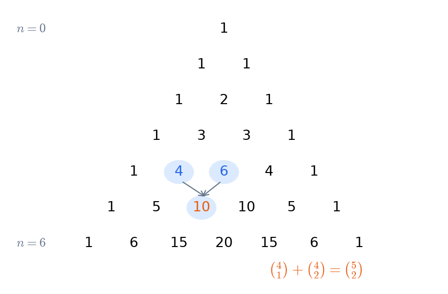

# Fondements
Programme CAPES : raisonnement et vocabulaire ensembliste, dénombrement, construction de N, Z, Q.

## Logique et quantificateurs
**Connecteurs.** $\neg P$, $P\wedge Q$, $P\vee Q$, $P\Rightarrow Q$ (équivaut à $\neg P\vee Q$), $P\Leftrightarrow Q$.
- Négation : $\neg(P\Rightarrow Q)\equiv P\wedge\neg Q$ ; lois de De Morgan $\neg(P\wedge Q)\equiv\neg P\vee\neg Q$.
- Contraposée : $P\Rightarrow Q$ équivaut à $\neg Q\Rightarrow\neg P$. La **réciproque** $Q\Rightarrow P$ n'est pas équivalente.

**Quantificateurs.** La négation échange $\forall$ et $\exists$ : $\neg(\forall x,\ P(x))\equiv \exists x,\ \neg P(x)$.
L'ordre compte : $\forall x\ \exists y$ (le $y$ dépend de $x$) est plus faible que $\exists y\ \forall x$. Exemple type : continuité contre continuité uniforme.

**Modes de raisonnement** à savoir nommer à l'oral :
- raisonnement direct, par contraposée, par l'absurde ;
- disjonction de cas ;
- analyse-synthèse (existence et unicité) ;
- récurrence simple, double et forte (équivalentes au fait que toute partie non vide de $\mathbb N$ a un plus petit élément).

**Pièges.** Une implication n'est pas une équivalence : énoncer clairement « condition nécessaire » et « condition suffisante ». La négation d'une limite doit être écrite proprement.

Sources : [Wikipédia – Calcul des propositions](https://fr.wikipedia.org/wiki/Calcul_des_propositions) · [Wikipédia – Raisonnement par récurrence](https://fr.wikipedia.org/wiki/Raisonnement_par_r%C3%A9currence) · [Le Frido](https://laurent.claessens-donadello.eu/frido.html)

## Ensembles et applications
**Ensembles.** Appartenance, inclusion, ensemble des parties $\mathcal P(E)$, produit cartésien. Opérations : $\cup,\cap$, complémentaire, différence. Les lois de De Morgan valent aussi pour les familles quelconques.

**Applications** $f:E\to F$.
- Image directe $f(A)$, image réciproque $f^{-1}(B)$. L'image réciproque commute avec $\cup,\cap$ et le complémentaire. L'image directe ne commute qu'avec $\cup$ : $f(A\cap B)\subset f(A)\cap f(B)$, avec égalité si $f$ est injective.
- Injective : $f(x)=f(y)\Rightarrow x=y$. Surjective : $f(E)=F$. Bijective : les deux, et il existe alors une réciproque $f^{-1}$.
- Composition : si $g\circ f$ est injective, $f$ l'est ; si $g\circ f$ est surjective, $g$ l'est.
- $f$ est bijective si et seulement s'il existe $g$ telle que $g\circ f=\mathrm{id}_E$ et $f\circ g=\mathrm{id}_F$.

**Ensembles finis.** Pour $f:E\to F$ entre ensembles finis de même cardinal : injective $\Leftrightarrow$ surjective $\Leftrightarrow$ bijective.

**Dénombrabilité** (culture) : $\mathbb N,\mathbb Z,\mathbb Q$ sont dénombrables. $\mathbb R$ ne l'est pas (argument diagonal de Cantor), ni $\mathcal P(\mathbb N)$ ; il n'existe aucune surjection $E\to\mathcal P(E)$.

Sources : [Wikipédia – Application (mathématiques)](https://fr.wikipedia.org/wiki/Application_%28math%C3%A9matiques%29) · [Wikipédia – Argument de la diagonale de Cantor](https://fr.wikipedia.org/wiki/Argument_de_la_diagonale_de_Cantor) · [Le Frido](https://laurent.claessens-donadello.eu/frido.html)

## Relations d'ordre et d'équivalence
**Relation d'équivalence** : réflexive, symétrique, transitive.
- Les classes d'équivalence forment une **partition** de $E$, et réciproquement toute partition définit une relation d'équivalence.
- L'ensemble quotient $E/\!\sim$ et la surjection canonique $x\mapsto\bar x$.
- Exemples à connaître : la congruence modulo $n$ (qui donne $\mathbb Z/n\mathbb Z$) ; $(a,b)\sim(c,d)\iff ad=bc$ (qui donne $\mathbb Q$) ; $f(x)=f(y)$, avec la factorisation $E\to E/\!\sim\ \to F$.

**Relation d'ordre** : réflexive, antisymétrique, transitive. L'ordre peut être total ($\le$ sur $\mathbb R$) ou partiel (divisibilité sur $\mathbb N$, inclusion sur $\mathcal P(E)$).
- Distinguer plus grand élément et élément maximal, majorant et borne supérieure (plus petit des majorants).
- Dans $(\mathbb N,\mid)$, la borne inférieure de $\{a,b\}$ est $\operatorname{pgcd}(a,b)$ ; dans $(\mathcal P(E),\subset)$, la borne supérieure est la réunion.

**Bon ordre.** Toute partie non vide de $\mathbb N$ admet un plus petit élément : c'est le fondement de la récurrence et de la division euclidienne.

Sources : [Wikipédia – Relation d'équivalence](https://fr.wikipedia.org/wiki/Relation_d%27%C3%A9quivalence) · [Wikipédia – Relation d'ordre](https://fr.wikipedia.org/wiki/Relation_d%27ordre)

## Dénombrement
Pour des ensembles finis, avec $|E|=p$ et $|F|=n$ :
- **Cardinal d'une réunion** : $|A\cup B|=|A|+|B|-|A\cap B|$, et en général la formule du crible de Poincaré.
- **Produit** : $|E\times F|=pn$. **Applications** : $|F^E|=n^p$. **Parties** : $|\mathcal P(E)|=2^p$.
- **Arrangements** (listes sans répétition) : $A_n^p=\dfrac{n!}{(n-p)!}$ injections de $E$ dans $F$. **Permutations** : $n!$.
- **Combinaisons** : $\binom np=\dfrac{n!}{p!\,(n-p)!}$ parties à $p$ éléments.

Formules à démontrer *combinatoirement* (double comptage) et *algébriquement* :
- symétrie $\binom np=\binom n{n-p}$ ;
- Pascal $\binom np=\binom{n-1}{p-1}+\binom{n-1}p$ ;
- binôme $(a+b)^n=\sum_k\binom nk a^kb^{n-k}$ dans un anneau où $ab=ba$ ;
- Vandermonde $\sum_k\binom ak\binom b{n-k}=\binom{a+b}n$.

**Méthode.** Identifier ce qu'on compte : l'ordre compte-t-il ? les répétitions sont-elles permises ? Construire une bijection avec un ensemble connu.

Sources : [Wikipédia – Combinaison (mathématiques)](https://fr.wikipedia.org/wiki/Combinaison_%28math%C3%A9matiques%29) · [Wikipédia – Formule du binôme de Newton](https://fr.wikipedia.org/wiki/Formule_du_bin%C3%B4me_de_Newton) · [Wikipédia – Principe d'inclusion-exclusion](https://fr.wikipedia.org/wiki/Principe_d%27inclusion-exclusion)

## Construction de N, Z et Q
**$\mathbb N$** : axiomes de Peano (zéro, successeur injectif, récurrence). L'addition, la multiplication et l'ordre se définissent par récurrence. Propriétés clés : bon ordre, archimédien, division euclidienne.

**$\mathbb Z$** : symétrisation de $(\mathbb N,+)$. On pose $\mathbb Z=\mathbb N^2/\!\sim$ avec $(a,b)\sim(c,d)\iff a+d=b+c$ ; la classe de $(a,b)$ « représente » $a-b$. On obtient un anneau commutatif intègre totalement ordonné, et $\mathbb N$ s'y plonge.

**$\mathbb Q$** : corps des fractions de $\mathbb Z$. On pose $\mathbb Q=\mathbb Z\times\mathbb Z^*/\!\sim$ avec $(a,b)\sim(c,d)\iff ad=bc$. Il faut vérifier que les opérations ne dépendent pas des représentants. $\mathbb Q$ est le plus petit corps contenant $\mathbb Z$, totalement ordonné et archimédien.

**Limites de $\mathbb Q$.**
- $\sqrt2\notin\mathbb Q$ : si $p^2=2q^2$ avec $p\wedge q=1$, alors $p$ est pair, puis $q$ aussi, contradiction.
- $\{x\in\mathbb Q : x^2<2\}$ n'a pas de borne supérieure dans $\mathbb Q$, d'où la construction de $\mathbb R$ (coupures de Dedekind ou suites de Cauchy, voir chapitre 09).

**Développement décimal** : un réel est rationnel si et seulement si son développement décimal est périodique à partir d'un certain rang.

Sources : [Wikipédia – Axiomes de Peano](https://fr.wikipedia.org/wiki/Axiomes_de_Peano) · [Wikipédia – Construction des entiers relatifs](https://fr.wikipedia.org/wiki/Construction_des_entiers_relatifs) · [Wikipédia – Construction des nombres réels](https://fr.wikipedia.org/wiki/Construction_des_nombres_r%C3%A9els) · [Le Frido](https://laurent.claessens-donadello.eu/frido.html)
