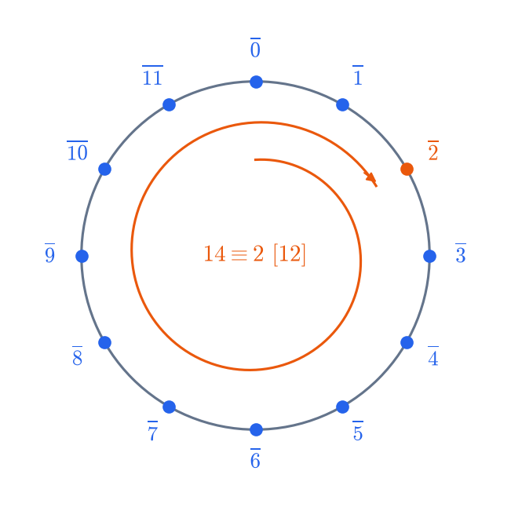

# Arithmétique
CAPES : arithmétique des entiers. Agrég : titre 3 (e).

## Divisibilité et sous-groupes de Z
**Divisibilité.** $a\mid b$ s'il existe $k\in\mathbb Z$ tel que $b=ka$. C'est une relation d'ordre (partiel) sur $\mathbb N$, mais seulement un préordre sur $\mathbb Z$, car $a\mid -a$.

**Division euclidienne.** Pour $a\in\mathbb Z$ et $b\in\mathbb N^*$, il existe un unique couple $(q,r)$ tel que $a=bq+r$ avec $0\le r<b$.
- Existence : $q=\lfloor a/b\rfloor$, ou bien le plus petit élément de $\{a-bk\ge0\}$.
- Unicité : si $bq+r=bq'+r'$, alors $b\mid r-r'$ et $|r-r'|<b$.

**Sous-groupes de $\mathbb Z$.** Ce sont exactement les $n\mathbb Z$ avec $n\in\mathbb N$.
- Preuve : si $H\ne\{0\}$, on prend $n=\min(H\cap\mathbb N^*)$. La division euclidienne d'un $h\in H$ par $n$ donne un reste dans $H$, donc nul.
- C'est la clé de Bézout : $a\mathbb Z+b\mathbb Z=d\mathbb Z$ avec $d=\operatorname{pgcd}(a,b)$, et $a\mathbb Z\cap b\mathbb Z=m\mathbb Z$ avec $m=\operatorname{ppcm}(a,b)$.

**Bases de numération.** Tout entier $n\ge1$ s'écrit de façon unique $\sum a_ib^i$ avec $0\le a_i<b$, par divisions euclidiennes successives. Critères de divisibilité par $3$, $9$, $11$ via les congruences de $10$.

Sources : [Wikipédia – Division euclidienne](https://fr.wikipedia.org/wiki/Division_euclidienne) · [Wikipédia – Divisibilité](https://fr.wikipedia.org/wiki/Divisibilit%C3%A9)

## PGCD, PPCM, Bézout et Gauss
**PGCD.** $d=\operatorname{pgcd}(a,b)$ est le générateur positif de $a\mathbb Z+b\mathbb Z$. C'est aussi le plus grand diviseur commun, et tout diviseur commun divise $d$.

**Algorithme d'Euclide.** $\operatorname{pgcd}(a,b)=\operatorname{pgcd}(b,r)$ où $r$ est le reste de $a$ par $b$. Le dernier reste non nul est le pgcd. La version **étendue** remonte les calculs et fournit $u,v$ avec $au+bv=d$.

**Théorème de Bézout.** $a\wedge b=1\iff\exists u,v\in\mathbb Z,\ au+bv=1$.

**Lemme de Gauss.** Si $a\mid bc$ et $a\wedge b=1$, alors $a\mid c$. (Preuve : $c=auc+bvc$.)
Conséquences :
- si $a\mid n$, $b\mid n$ et $a\wedge b=1$, alors $ab\mid n$ ;
- forme irréductible d'une fraction ;
- résolution de $ax+by=c$ : solvable si et seulement si $d\mid c$, et les solutions sont $(x_0+kb/d,\ y_0-ka/d)$.

**PPCM.** $\operatorname{pgcd}(a,b)\cdot\operatorname{ppcm}(a,b)=|ab|$.

**Piège.** Le lemme de Gauss, et non « le lemme d'Euclide », sert à résoudre les équations diophantiennes. Il faut le citer avec l'hypothèse de primalité entre eux.

Sources : [Wikipédia – Algorithme d'Euclide](https://fr.wikipedia.org/wiki/Algorithme_d%27Euclide) · [Wikipédia – Théorème de Bachet-Bézout](https://fr.wikipedia.org/wiki/Th%C3%A9or%C3%A8me_de_Bachet-B%C3%A9zout) · [Wikipédia – Lemme d'Euclide](https://fr.wikipedia.org/wiki/Lemme_d%27Euclide)

## Nombres premiers
**Définition.** $p\ge2$ est premier si ses seuls diviseurs positifs sont $1$ et $p$. Tout entier $n\ge2$ a un plus petit diviseur $>1$, qui est premier.

**Lemme d'Euclide.** Si $p$ est premier et $p\mid ab$, alors $p\mid a$ ou $p\mid b$. C'est le lemme de Gauss, puisque $p\nmid a\Rightarrow p\wedge a=1$.

**Théorème fondamental de l'arithmétique.** Tout $n\ge2$ s'écrit de façon unique (à l'ordre près) comme produit de nombres premiers.
- Existence : récurrence forte.
- Unicité : lemme d'Euclide.
- Valuations $p$-adiques : $v_p(ab)=v_p(a)+v_p(b)$, $\operatorname{pgcd}=\prod p^{\min}$, $\operatorname{ppcm}=\prod p^{\max}$.

**Infinitude des nombres premiers** (Euclide) : $N=p_1\cdots p_k+1$ a un facteur premier hors de la liste.

**Crible d'Ératosthène** : si $n$ n'est pas premier, il a un facteur premier $\le\sqrt n$.

Culture : $\sum 1/p$ diverge ; théorème des nombres premiers $\pi(x)\sim x/\ln x$ (admis).

Sources : [Wikipédia – Nombre premier](https://fr.wikipedia.org/wiki/Nombre_premier) · [Wikipédia – Théorème fondamental de l'arithmétique](https://fr.wikipedia.org/wiki/Th%C3%A9or%C3%A8me_fondamental_de_l%27arithm%C3%A9tique) · [Wikipédia – Crible d'Ératosthène](https://fr.wikipedia.org/wiki/Crible_d%27%C3%89ratosth%C3%A8ne)

## Congruences et anneaux Z/nZ
**Congruence.** $a\equiv b\ [n]$ si $n\mid a-b$. C'est une relation d'équivalence compatible avec $+$ et $\times$.

**L'anneau $\mathbb Z/n\mathbb Z$** : quotient de $\mathbb Z$ par $n\mathbb Z$, avec $n$ éléments $\bar0,\dots,\overline{n-1}$.
- $\bar a$ est inversible $\iff a\wedge n=1$. L'inverse se calcule par Euclide étendu, car $au+nv=1$ donne $\bar a^{-1}=\bar u$.
- $\mathbb Z/n\mathbb Z$ est un corps $\iff$ il est intègre $\iff n$ est premier.

**Méthodes.**
- Calcul de $a^k\bmod n$ par exponentiation rapide.
- Tables de puissances, périodicité des restes.
- Équations $ax\equiv b\ [n]$ : solvables si et seulement si $\operatorname{pgcd}(a,n)\mid b$.

**Applications :** critères de divisibilité ; preuve par 9 ; clés de contrôle (RIB, ISBN) ; le chiffrement RSA (voir Euler).

Sources : [Wikipédia – Congruence sur les entiers](https://fr.wikipedia.org/wiki/Congruence_sur_les_entiers) · [Wikipédia – Anneau Z/nZ](https://fr.wikipedia.org/wiki/Anneau_Z/nZ)

## Indicatrice d'Euler, théorèmes de Fermat et d'Euler
**Indicatrice d'Euler.** $\varphi(n)=|(\mathbb Z/n\mathbb Z)^\times|=\#\{1\le k\le n : k\wedge n=1\}$.
- $\varphi(p^k)=p^k-p^{k-1}$.
- $\varphi$ est multiplicative ($\varphi(mn)=\varphi(m)\varphi(n)$ si $m\wedge n=1$, par le théorème chinois).
- D'où $\varphi(n)=n\prod_{p\mid n}(1-1/p)$.
- $\sum_{d\mid n}\varphi(d)=n$ (compter les éléments de $\mathbb Z/n\mathbb Z$ selon leur ordre).

**Petit théorème de Fermat.** Si $p$ est premier et $p\nmid a$, alors $a^{p-1}\equiv1\ [p]$ ; pour tout $a$, $a^p\equiv a\ [p]$.
Deux preuves :
- Lagrange dans le groupe $(\mathbb Z/p\mathbb Z)^\times$ d'ordre $p-1$ ;
- binôme, car $p\mid\binom pk$ pour $0<k<p$, puis récurrence sur $a$.

**Théorème d'Euler.** Si $a\wedge n=1$, alors $a^{\varphi(n)}\equiv1\ [n]$ (Lagrange dans $(\mathbb Z/n\mathbb Z)^\times$).

**RSA.** On prend $n=pq$ et $ed\equiv1\ [\varphi(n)]$ ; alors $(m^e)^d\equiv m\ [n]$.

**Piège.** La réciproque de Fermat est fausse : il existe des nombres de Carmichael, comme $561$. Le **théorème de Wilson** donne, lui, une caractérisation : $p$ premier $\iff (p-1)!\equiv-1\ [p]$.

Sources : [Wikipédia – Indicatrice d'Euler](https://fr.wikipedia.org/wiki/Indicatrice_d%27Euler) · [Wikipédia – Petit théorème de Fermat](https://fr.wikipedia.org/wiki/Petit_th%C3%A9or%C3%A8me_de_Fermat) · [Wikipédia – Théorème d'Euler (arithmétique)](https://fr.wikipedia.org/wiki/Th%C3%A9or%C3%A8me_d%27Euler_%28arithm%C3%A9tique%29)

## Théorème chinois
**Énoncé.** Si $m\wedge n=1$, l'application $\mathbb Z/mn\mathbb Z\to\mathbb Z/m\mathbb Z\times\mathbb Z/n\mathbb Z$, $\bar x\mapsto(\dot x,\ddot x)$ est un **isomorphisme d'anneaux**.
- Preuve : c'est un morphisme bien défini. Il est injectif, car $m\mid x$ et $n\mid x$ donnent $mn\mid x$ (Gauss). Il est surjectif car les cardinaux sont égaux.

**Inverse explicite.** Avec $um+vn=1$, la solution de $x\equiv a\ [m]$, $x\equiv b\ [n]$ est $x\equiv bum+avn\ [mn]$.

**Conséquences.**
- $(\mathbb Z/mn\mathbb Z)^\times\simeq(\mathbb Z/m\mathbb Z)^\times\times(\mathbb Z/n\mathbb Z)^\times$, d'où la multiplicativité de $\varphi$.
- $\mathbb Z/mn\mathbb Z\simeq\mathbb Z/m\times\mathbb Z/n$ **en tant que groupes** si et seulement si $m\wedge n=1$ ; par exemple, $\mathbb Z/4\not\simeq(\mathbb Z/2)^2$.
- Version générale (agrég) : dans un anneau commutatif, $A/(I\cap J)\simeq A/I\times A/J$ si $I+J=A$.

**Méthode.** Pour un système de congruences, vérifier que les modules sont premiers entre eux deux à deux. Sinon, vérifier la compatibilité modulo les pgcd.

Sources : [Wikipédia – Théorème des restes chinois](https://fr.wikipedia.org/wiki/Th%C3%A9or%C3%A8me_des_restes_chinois)

## Le groupe des inversibles de Z/nZ @agreg
**Structure de $(\mathbb Z/n\mathbb Z)^\times$.**
- **$\mathbb F_p^\times$ est cyclique**. Plus généralement, tout sous-groupe fini du groupe multiplicatif d'un corps est cyclique. Preuve : pour chaque $d\mid p-1$, le nombre d'éléments d'ordre $d$ est $0$ ou $\varphi(d)$, car $X^d-1$ a au plus $d$ racines. Comme $\sum_{d\mid p-1}\varphi(d)=p-1$, il vaut toujours $\varphi(d)$.
- $(\mathbb Z/p^k\mathbb Z)^\times$ est cyclique pour $p$ premier impair (relever une racine primitive modulo $p$ ; $1+p$ est d'ordre $p^{k-1}$).
- $(\mathbb Z/2^k\mathbb Z)^\times\simeq\mathbb Z/2\times\mathbb Z/2^{k-2}$ pour $k\ge3$, engendré par $-1$ et $5$.
- Par le théorème chinois, $(\mathbb Z/n\mathbb Z)^\times$ est cyclique si et seulement si $n\in\{1,2,4,p^k,2p^k\}$ avec $p$ premier impair.

**Applications.**
- Carrés modulo $p$ : critère d'Euler $a^{(p-1)/2}\equiv\left(\frac ap\right)$.
- $-1$ est un carré modulo $p$ si et seulement si $p\equiv1\ [4]$.
- Il existe une infinité de premiers $\equiv1\ [4]$, ou plus généralement $\equiv1\ [n]$ (via les polynômes cyclotomiques).
- Tests de primalité (Miller–Rabin).

*Recasages typiques : leçons « Groupes finis », « Anneaux Z/nZ », « Corps finis », « Exemples de nombres premiers ».*

Sources : [Wikipédia – Racine primitive modulo n](https://fr.wikipedia.org/wiki/Racine_primitive_modulo_n) · [Wikipédia – Critère d'Euler](https://fr.wikipedia.org/wiki/Crit%C3%A8re_d%27Euler) · [Le Frido](https://laurent.claessens-donadello.eu/frido.html)
