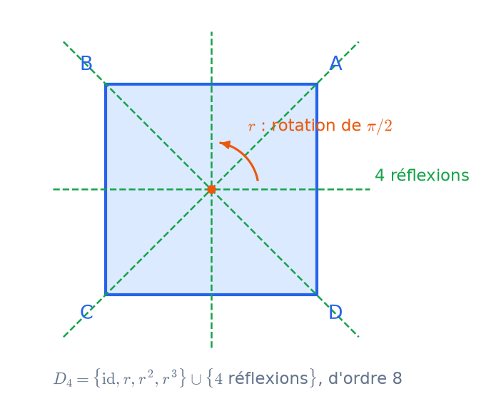

# Groupes
CAPES : chapitre Groupes. Agrég : titre 2.

## Groupes, sous-groupes, morphismes
**Groupe** : loi associative, élément neutre, inverses. Exemples de référence :
- $(\mathbb Z,+)$, $(\mathbb U,\times)$, $\mathbb U_n$ ;
- $(\mathbb Z/n\mathbb Z,+)$ et $(\mathbb Z/n\mathbb Z)^\times$ ;
- $\mathfrak S_n$, $GL_n(K)$, le groupe des isométries d'une figure.

**Sous-groupe** : $H\ne\emptyset$ et $x,y\in H\Rightarrow xy^{-1}\in H$. Une intersection de sous-groupes est un sous-groupe, mais une réunion ne l'est en général pas. Le sous-groupe engendré $\langle A\rangle$ est le plus petit sous-groupe contenant $A$, formé des produits d'éléments de $A$ et de leurs inverses.

**Morphisme** : $f(xy)=f(x)f(y)$. Alors $f(e)=e'$ et $f(x^{-1})=f(x)^{-1}$.
- $\ker f$ et $\operatorname{Im} f$ sont des sous-groupes, et $f$ est injectif $\iff\ker f=\{e\}$.
- Exemples : $\exp:(\mathbb R,+)\to(\mathbb R_+^*,\times)$ ; $\det:GL_n\to K^*$ ; la signature $\varepsilon:\mathfrak S_n\to\{\pm1\}$ ; $\theta\mapsto e^{i\theta}$ (de noyau $2\pi\mathbb Z$).
- Isomorphisme, automorphisme ; les automorphismes intérieurs $x\mapsto gxg^{-1}$.

**Produit direct** $G\times H$. Il est abélien si et seulement si $G$ et $H$ le sont.

Sources : [Wikipédia – Groupe (mathématiques)](https://fr.wikipedia.org/wiki/Groupe_%28math%C3%A9matiques%29) · [Wikipédia – Morphisme de groupes](https://fr.wikipedia.org/wiki/Morphisme_de_groupes) · [Le Frido](https://laurent.claessens-donadello.eu/frido.html)

## Ordre d'un élément et théorème de Lagrange
**Ordre de $x$** : le plus petit $n\ge1$ tel que $x^n=e$, ou $\infty$ s'il n'existe pas. C'est aussi le cardinal de $\langle x\rangle$, et l'on a $x^k=e\iff n\mid k$.
- $x^k$ est d'ordre $n/\operatorname{pgcd}(n,k)$.
- Si $xy=yx$ et que les ordres sont premiers entre eux, alors $\operatorname{ord}(xy)=\operatorname{ord}(x)\operatorname{ord}(y)$. Sans commutation, c'est faux.

**Théorème de Lagrange.** Si $G$ est fini et $H\le G$, alors $|H|$ divise $|G|$.
- Preuve : les classes à gauche $gH$ partitionnent $G$ et ont toutes $|H|$ éléments. D'où $|G|=[G:H]\,|H|$.
- Corollaires : l'ordre d'un élément divise $|G|$, donc $x^{|G|}=e$ (ce qui donne Fermat et Euler) ; un groupe d'ordre premier est cyclique.

**Piège.** La réciproque est fausse : $\mathfrak A_4$, d'ordre 12, n'a pas de sous-groupe d'ordre 6. Elle est vraie pour les groupes cycliques, et Cauchy (agrég) en donne une réciproque partielle : si $p$ premier divise $|G|$, il existe un élément d'ordre $p$.

Sources : [Wikipédia – Théorème de Lagrange sur les groupes](https://fr.wikipedia.org/wiki/Th%C3%A9or%C3%A8me_de_Lagrange_sur_les_groupes) · [Wikipédia – Ordre (théorie des groupes)](https://fr.wikipedia.org/wiki/Ordre_%28th%C3%A9orie_des_groupes%29)

## Groupes monogènes et cycliques
**Monogène** : engendré par un élément. **Cyclique** : monogène et fini.
- **Classification** : un groupe monogène infini est isomorphe à $\mathbb Z$ ; un groupe cyclique d'ordre $n$ est isomorphe à $\mathbb Z/n\mathbb Z$ (via $k\mapsto x^k$, qui passe au quotient par son noyau $n\mathbb Z$).
- **Générateurs** de $\mathbb Z/n\mathbb Z$ : les $\bar k$ avec $k\wedge n=1$ ; il y en a $\varphi(n)$.
- **Sous-groupes** de $\mathbb Z/n\mathbb Z$ : pour chaque $d\mid n$, un unique sous-groupe d'ordre $d$, engendré par $\overline{n/d}$, et il est cyclique.

**Racines de l'unité.** $\mathbb U_n=\{e^{2ik\pi/n}\}\simeq\mathbb Z/n\mathbb Z$. Ses générateurs sont les racines primitives $e^{2ik\pi/n}$ avec $k\wedge n=1$.

**Formule** $\sum_{d\mid n}\varphi(d)=n$ : on compte les éléments de $\mathbb Z/n\mathbb Z$ selon leur ordre.

**Critère.** Un groupe abélien fini est cyclique si et seulement s'il a, pour chaque $d$, au plus $d$ éléments vérifiant $x^d=e$. Cela sert à montrer que $\mathbb F_q^\times$ est cyclique.

Sources : [Wikipédia – Groupe cyclique](https://fr.wikipedia.org/wiki/Groupe_cyclique) · [Wikipédia – Racine de l'unité](https://fr.wikipedia.org/wiki/Racine_de_l%27unit%C3%A9)

## Groupe symétrique
**$\mathfrak S_n$** : les bijections de $\{1,\dots,n\}$ ; $|\mathfrak S_n|=n!$, et le groupe n'est pas abélien pour $n\ge3$.

**Cycles.** Toute permutation se décompose de façon unique, à l'ordre près, en produit de cycles **à supports disjoints**, qui commutent entre eux. Les supports sont les orbites de $\langle\sigma\rangle$. L'ordre de $\sigma$ est le ppcm des longueurs des cycles.

**Générateurs.**
- Les transpositions engendrent $\mathfrak S_n$ : un $k$-cycle est un produit de $k-1$ transpositions.
- Les transpositions $(i\ i+1)$ suffisent, ainsi que $(1\ 2)$ et $(1\ 2\cdots n)$.

**Signature.** $\varepsilon(\sigma)=\prod_{i<j}\frac{\sigma(j)-\sigma(i)}{j-i}=(-1)^{\text{nombre d'inversions}}$.
- C'est l'unique morphisme non trivial $\mathfrak S_n\to\{\pm1\}$, et $\varepsilon(\text{transposition})=-1$.
- Un $k$-cycle a pour signature $(-1)^{k-1}$.

**Groupe alterné** $\mathfrak A_n=\ker\varepsilon$, d'ordre $n!/2$, engendré par les 3-cycles. Il est simple pour $n\ge5$ (agrég).

**Conjugaison** : $\tau(a_1\cdots a_k)\tau^{-1}=(\tau(a_1)\cdots\tau(a_k))$. Deux permutations sont conjuguées si et seulement si elles ont le même type, c'est-à-dire les mêmes longueurs de cycles.

**Lien** : le déterminant $\det(a_{ij})=\sum_\sigma\varepsilon(\sigma)\prod a_{\sigma(i)i}$.

Sources : [Wikipédia – Groupe symétrique](https://fr.wikipedia.org/wiki/Groupe_sym%C3%A9trique) · [Wikipédia – Signature d'une permutation](https://fr.wikipedia.org/wiki/Signature_d%27une_permutation)

## Actions de groupe
**Action** de $G$ sur $X$ : $g\cdot(h\cdot x)=(gh)\cdot x$ et $e\cdot x=x$. De manière équivalente, c'est un morphisme $G\to\mathfrak S(X)$.
- **Orbite** $G\cdot x$. Les orbites partitionnent $X$.
- **Stabilisateur** $G_x=\{g : g\cdot x=x\}$. C'est un sous-groupe, et $G_{g\cdot x}=gG_xg^{-1}$.

**Relation orbite-stabilisateur.** $gG_x\mapsto g\cdot x$ est une bijection $G/G_x\to G\cdot x$, d'où $|G\cdot x|=[G:G_x]$, qui divise $|G|$.

**Exemples d'actions.**
- Action de $G$ sur lui-même par translation : on obtient le théorème de Cayley, $G\hookrightarrow\mathfrak S_{|G|}$.
- Action par conjugaison : les orbites sont les classes de conjugaison et le stabilisateur est le centralisateur.
- $GL_n$ agit sur $K^n$ (deux orbites : $\{0\}$ et le reste) ; par équivalence sur les matrices (orbites = rang) ; par similitude (orbites = classes de similitude).
- Isométries d'une figure agissant sur les sommets, les faces ou les diagonales.

**Formule de Burnside** (dénombrement des coloriages) : le nombre d'orbites vaut $\frac1{|G|}\sum_g|\mathrm{Fix}(g)|$.

Sources : [Wikipédia – Action de groupe (mathématiques)](https://fr.wikipedia.org/wiki/Action_de_groupe_%28math%C3%A9matiques%29) · [Wikipédia – Lemme de Burnside](https://fr.wikipedia.org/wiki/Lemme_de_Burnside)

## Groupes d'isométries d'une figure
**Principe.** Les isométries du plan (ou de l'espace) qui laissent globalement invariante une figure $F$ forment un groupe $\mathrm{Is}(F)$. Pour une figure bornée, elles fixent l'isobarycentre des sommets.

**Polygone régulier à $n$ côtés : le groupe diédral $D_n$**, d'ordre $2n$.
- Il contient $n$ rotations de centre $O$ et d'angles $2k\pi/n$, qui forment le sous-groupe cyclique $\langle r\rangle$.
- Il contient $n$ réflexions d'axes passant par $O$ et par un sommet ou le milieu d'un côté.
- Présentation : $r^n=s^2=e$, $srs=r^{-1}$.
- Preuve de l'ordre : $D_n$ agit fidèlement sur les sommets. Le stabilisateur d'un sommet a 2 éléments, l'identité et une réflexion, et l'orbite a $n$ éléments.

**Exemples.**
- Rectangle non carré : $\{\mathrm{id},\ s_1,\ s_2,\ r_\pi\}\simeq(\mathbb Z/2)^2$.
- Losange non carré : le même groupe.
- Triangle équilatéral : $D_3\simeq\mathfrak S_3$.

**Méthode.** Une isométrie conserve les distances : elle envoie les sommets sur les sommets et conserve leurs voisinages. Elle est déterminée par l'image de trois points non alignés.

Sources : [Wikipédia – Groupe diédral](https://fr.wikipedia.org/wiki/Groupe_di%C3%A9dral) · [Wikipédia – Groupe de symétrie](https://fr.wikipedia.org/wiki/Groupe_de_sym%C3%A9trie)

## Sous-groupes distingués et quotients @agreg
**Sous-groupe distingué** $H\lhd G$ : $gHg^{-1}=H$ pour tout $g$. De manière équivalente, les classes à gauche et à droite coïncident, ou encore $H$ est une réunion de classes de conjugaison.
- Exemples : les noyaux de morphismes ; tout sous-groupe d'indice 2 ; le centre $Z(G)$ ; $SL_n\lhd GL_n$ ; $\mathfrak A_n\lhd\mathfrak S_n$.
- Le groupe de Klein $V_4\lhd\mathfrak A_4$.

**Groupe quotient** $G/H$, avec $(xH)(yH)=xyH$ (bien défini car $H$ est distingué). La surjection canonique a pour noyau $H$.

**Théorèmes d'isomorphisme.**
1. Factorisation : $G/\ker f\simeq\operatorname{Im} f$.
2. $HK/K\simeq H/(H\cap K)$ si $K\lhd G$.
3. $(G/K)/(H/K)\simeq G/H$ pour $K\subset H$ distingués.
4. Correspondance : les sous-groupes de $G/H$ correspondent aux sous-groupes de $G$ contenant $H$.

**Applications.**
- $GL_n/SL_n\simeq K^*$ ; $\mathbb R/\mathbb Z\simeq\mathbb U$ ; $G/Z(G)\simeq\mathrm{Int}(G)$.
- Si $G/Z(G)$ est cyclique, alors $G$ est abélien.
- Groupes **simples** : $\mathbb Z/p$ et $\mathfrak A_n$ pour $n\ge5$.
- Groupe dérivé et abélianisé : $D(\mathfrak S_n)=\mathfrak A_n$.

Sources : [Wikipédia – Sous-groupe normal](https://fr.wikipedia.org/wiki/Sous-groupe_normal) · [Wikipédia – Groupe quotient](https://fr.wikipedia.org/wiki/Groupe_quotient) · [Le Frido](https://laurent.claessens-donadello.eu/frido.html)

## Formule des classes et conjugaison @agreg
**Formule des classes.** Pour $G$ fini agissant sur $X$ fini, avec $x_i$ des représentants des orbites non réduites à un point :
$$|X|=|X^G|+\sum_i[G:G_{x_i}]$$
Pour l'action par conjugaison : $|G|=|Z(G)|+\sum_i[G:C(x_i)]$.

**$p$-groupes.**
- Un $p$-groupe non trivial a un centre non trivial (tous les indices de la somme sont divisibles par $p$).
- Un groupe d'ordre $p^2$ est abélien.
- Si un $p$-groupe agit sur $X$, alors $|X|\equiv|X^G|\ [p]$.

**Théorème de Cauchy** (preuve de McKay). On fait agir $\mathbb Z/p$ par rotation sur $\{(x_1,\dots,x_p) : x_1\cdots x_p=e\}$, ensemble de cardinal $|G|^{p-1}$ ; on en déduit l'existence d'un élément d'ordre $p$.

**Classes de conjugaison.**
- Dans $\mathfrak S_n$, elles correspondent aux types de cycles, et à la partition de $n$.
- Dans $GL_n(\mathbb C)$, elles correspondent aux réductions de Jordan.
- Le cardinal de la classe de $x$ vaut $[G:C(x)]$.

*Recasages typiques : « Groupe opérant sur un ensemble », « Groupes finis », « $p$-groupes, théorèmes de Sylow » (hors programme officiel mais fréquents en développement).*

Sources : [Wikipédia – Formule des classes](https://fr.wikipedia.org/wiki/Formule_des_classes) · [Wikipédia – Théorème de Cauchy (groupes)](https://fr.wikipedia.org/wiki/Th%C3%A9or%C3%A8me_de_Cauchy_%28groupes%29)

## Groupes abéliens finis @agreg
**Théorème de structure.** Tout groupe abélien fini est isomorphe à $\mathbb Z/d_1\times\cdots\times\mathbb Z/d_r$, avec $d_1\mid d_2\mid\cdots\mid d_r$ (facteurs invariants, uniques). De façon équivalente, c'est un produit de $\mathbb Z/p^{k}$ (diviseurs élémentaires).

**Ingrédients de la preuve.**
- L'**exposant** (ppcm des ordres) est atteint par un élément.
- Un élément d'ordre maximal engendre un facteur direct (via un caractère qui se prolonge, ou par récurrence).
- Autre voie : réduction de Smith des matrices sur $\mathbb Z$.

**Conséquences.**
- Liste des groupes abéliens d'ordre donné : pour l'ordre $p^n$, on obtient les partitions de $n$. Par exemple, il y a 3 groupes abéliens d'ordre 8.
- $G$ est cyclique si et seulement si son exposant vaut $|G|$.
- Le groupe dual $\hat G=\mathrm{Hom}(G,\mathbb C^*)\simeq G$ (non canoniquement). Les caractères séparent les points et vérifient des relations d'orthogonalité, qui mènent à la transformée de Fourier sur un groupe fini.

**Exemples** : $(\mathbb Z/n\mathbb Z)^\times$ ; $(\mathbb Z/8)^\times\simeq(\mathbb Z/2)^2$ ; $\mathbb Z/6\simeq\mathbb Z/2\times\mathbb Z/3$.

Sources : [Wikipédia – Théorème de Kronecker (groupes abéliens finis)](https://fr.wikipedia.org/wiki/Th%C3%A9or%C3%A8me_de_Kronecker) · [Le Frido](https://laurent.claessens-donadello.eu/frido.html)

## Groupes classiques @agreg
**Définitions** (pour $E$ de dimension finie $n$) :
- $GL(E)$, et $SL(E)=\ker\det$ ;
- $O(n)=\{M : {}^tMM=I\}$ et $SO(n)=O(n)\cap SL_n$ ;
- $U(n)=\{M : M^*M=I\}$ et $SU(n)$.

**Générateurs.**
- $GL(E)$ est engendré par les transvections et les dilatations, et $SL(E)$ par les transvections (pivot de Gauss).
- $O(n)$ est engendré par les réflexions, avec au plus $n$ d'entre elles (Cartan–Dieudonné) ; $SO(n)$ est engendré par les renversements, pour $n\ge3$.

**Centres.** $Z(GL_n)=K^*I_n$ et $Z(SL_n)=\mathbb U_n(K)I_n$. $Z(O(n))=\{\pm I\}$.

**Topologie** (sur $\mathbb R$ ou $\mathbb C$).
- $GL_n(\mathbb C)$ est connexe ; $GL_n(\mathbb R)$ a deux composantes connexes, selon le signe du déterminant.
- $O(n)$ est compact, avec deux composantes connexes ; $SO(n)$ est connexe.
- $U(n)$ et $SU(n)$ sont compacts et connexes.

**Cardinaux sur $\mathbb F_q$.** $|GL_n(\mathbb F_q)|=\prod_{k=0}^{n-1}(q^n-q^k)$ : on compte les bases colonne par colonne.

**Décompositions.** Polaire $GL_n(\mathbb R)\simeq O(n)\times S_n^{++}$ ; $QR$ (Gram–Schmidt).

Sources : [Wikipédia – Groupe classique](https://fr.wikipedia.org/wiki/Groupe_classique) · [Wikipédia – Groupe orthogonal](https://fr.wikipedia.org/wiki/Groupe_orthogonal) · [Le Frido](https://laurent.claessens-donadello.eu/frido.html)

## Isométries des polyèdres réguliers @agreg
**Les cinq solides de Platon** : tétraèdre, cube, octaèdre, dodécaèdre, icosaèdre. Le cube et l'octaèdre sont duaux, de même que le dodécaèdre et l'icosaèdre, et des polyèdres duaux ont le même groupe.

**Groupes des rotations** (déplacements) :
- tétraèdre : $\mathrm{Is}^+\simeq\mathfrak A_4$, d'ordre 12 (action sur les 4 sommets) ;
- cube : $\mathrm{Is}^+\simeq\mathfrak S_4$, d'ordre 24 (action sur les 4 grandes diagonales) ;
- icosaèdre : $\mathrm{Is}^+\simeq\mathfrak A_5$, d'ordre 60 (action sur les 5 cubes inscrits dans le dodécaèdre).

**Groupes complets** : $\mathrm{Is}=\mathrm{Is}^+\times\{\pm\mathrm{id}\}$ quand $-\mathrm{id}$ préserve le solide, ce qui est le cas du cube et de l'icosaèdre. Pour le tétraèdre, $\mathrm{Is}\simeq\mathfrak S_4$, car $-\mathrm{id}$ ne le préserve pas.

**Méthode de calcul.**
- Ordre par orbite-stabilisateur. Pour le cube : 8 sommets, et un stabilisateur d'ordre 3 parmi les rotations, d'où $24$.
- Identification par une action fidèle sur un ensemble à 4 ou 5 éléments.
- Dénombrement des rotations par type d'axe (sommet, milieu d'arête, centre de face).

*Recasages : « Groupes finis », « Groupe opérant sur un ensemble », « Groupe des isométries », « Exemples de sous-groupes de $\mathfrak S_n$ ».*

Sources : [Wikipédia – Solide de Platon](https://fr.wikipedia.org/wiki/Solide_de_Platon) · [Wikipédia – Symétrie octaédrique](https://fr.wikipedia.org/wiki/Sym%C3%A9trie_octa%C3%A9drique) · [Le Frido](https://laurent.claessens-donadello.eu/frido.html)
