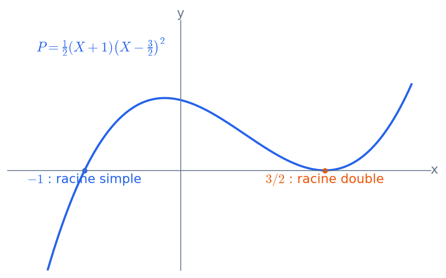

# Anneaux, corps et polynômes
CAPES : polynômes à coefficients réels ou complexes. Agrég : titre 3.

## Arithmétique dans K[X]
**Degré.** $\deg(PQ)=\deg P+\deg Q$, car $K$ est intègre ; d'où $K[X]$ intègre et $K[X]^\times=K^*$. On a $\deg(P+Q)\le\max(\deg P,\deg Q)$.

**Division euclidienne.** Pour $B\ne0$, il existe un unique couple $(Q,R)$ tel que $A=BQ+R$ avec $\deg R<\deg B$.

**Idéaux.** $K[X]$ est principal : tout idéal s'écrit $(P)$, avec $P$ unitaire unique si l'idéal est non nul. La preuve copie celle des sous-groupes de $\mathbb Z$, avec le degré à la place de la valeur absolue.

**PGCD, Bézout, Gauss.** Les énoncés sont les mêmes que dans $\mathbb Z$ :
- l'algorithme d'Euclide donne le pgcd unitaire et les coefficients de Bézout $AU+BV=D$ ;
- lemme de Gauss : si $A\mid BC$ et $A\wedge B=1$, alors $A\mid C$.

**Irréductibles.** Décomposition unique en produit d'irréductibles unitaires (à l'ordre près).

**Remarque.** Le pgcd ne dépend pas du corps : si $K\subset L$, le pgcd calculé dans $L[X]$ est le même, car l'algorithme d'Euclide se fait dans $K[X]$.

Sources : [Wikipédia – Division d'un polynôme](https://fr.wikipedia.org/wiki/Division_d%27un_polyn%C3%B4me) · [Wikipédia – Arithmétique des polynômes](https://fr.wikipedia.org/wiki/Arithm%C3%A9tique_des_polyn%C3%B4mes)

## Racines, multiplicité, relations coefficients-racines
**Racine.** $P(a)=0\iff(X-a)\mid P$ (division par $X-a$, dont le reste vaut $P(a)$). Un polynôme non nul de degré $n$ a au plus $n$ racines. Conséquence : un polynôme ayant une infinité de racines est nul, et l'on peut identifier polynôme et fonction polynomiale sur un corps infini.

**Multiplicité.** $a$ est racine d'ordre $m$ si $(X-a)^m\mid P$ et $(X-a)^{m+1}\nmid P$. En caractéristique nulle, c'est équivalent à $P(a)=\dots=P^{(m-1)}(a)=0\ne P^{(m)}(a)$ (formule de Taylor).

**Polynôme scindé** $P=a_n\prod(X-x_i)$. **Relations de Viète** : $\sigma_k(x_1,\dots,x_n)=(-1)^k\,a_{n-k}/a_n$. En particulier :
- la somme des racines vaut $-a_{n-1}/a_n$ ;
- le produit des racines vaut $(-1)^na_0/a_n$.

**Interpolation de Lagrange.** Pour $n+1$ points d'abscisses distinctes, il existe un unique polynôme de degré $\le n$ qui les interpole : $L=\sum y_i\prod_{j\ne i}\frac{X-x_j}{x_i-x_j}$.

**Racines rationnelles.** Si $p/q$ (irréductible) est racine de $P\in\mathbb Z[X]$, alors $p\mid a_0$ et $q\mid a_n$.

Sources : [Wikipédia – Racine d'un polynôme](https://fr.wikipedia.org/wiki/Racine_d%27un_polyn%C3%B4me) · [Wikipédia – Relations entre coefficients et racines](https://fr.wikipedia.org/wiki/Relations_entre_coefficients_et_racines) · [Wikipédia – Interpolation lagrangienne](https://fr.wikipedia.org/wiki/Interpolation_lagrangienne)

## Polynômes irréductibles sur R et C
**Théorème de d'Alembert–Gauss.** Tout polynôme non constant de $\mathbb C[X]$ a une racine : $\mathbb C$ est algébriquement clos. Quelques preuves :
- analyse : $|P|$ atteint un minimum sur $\mathbb C$, et ce minimum est nul (lemme de d'Alembert) ;
- analyse complexe : théorème de Liouville ;
- algèbre : théorie de Galois et 2-Sylow.

**Irréductibles de $\mathbb C[X]$** : les polynômes de degré 1. Tout polynôme est scindé.

**Irréductibles de $\mathbb R[X]$** : les polynômes de degré 1, et ceux de degré 2 à discriminant $<0$.
- Preuve : les racines non réelles de $P\in\mathbb R[X]$ vont par paires conjuguées $z,\bar z$ (de même multiplicité). Le facteur $(X-z)(X-\bar z)=X^2-2\operatorname{Re}(z)X+|z|^2$ est réel.
- Conséquence : un polynôme réel de degré impair a une racine réelle (voir aussi le TVI).

**Exemples de factorisation.**
- $X^n-1=\prod_k(X-e^{2ik\pi/n})$ dans $\mathbb C[X]$ ; dans $\mathbb R[X]$, on regroupe les racines conjuguées.
- $X^4+1=(X^2+\sqrt2X+1)(X^2-\sqrt2X+1)$.

**Piège.** Un polynôme sans racine n'est pas irréductible en degré $\ge4$ : par exemple, $X^4+1$ sur $\mathbb R$.

Sources : [Wikipédia – Théorème de d'Alembert-Gauss](https://fr.wikipedia.org/wiki/Th%C3%A9or%C3%A8me_de_d%27Alembert-Gauss) · [Wikipédia – Polynôme irréductible](https://fr.wikipedia.org/wiki/Polyn%C3%B4me_irr%C3%A9ductible)

## Anneaux, idéaux et quotients @agreg
**Anneau commutatif unitaire.** Les morphismes envoient $1$ sur $1$. **Idéal** $I$ : sous-groupe additif tel que $AI\subset I$. Les noyaux de morphismes sont exactement les idéaux.

**Quotient** $A/I$ : l'anneau des classes, avec la propriété universelle de factorisation $A/\ker f\simeq\operatorname{Im}f$.
- $I$ est **premier** $\iff A/I$ est intègre.
- $I$ est **maximal** $\iff A/I$ est un corps.
- Un idéal maximal est premier. L'existence d'un idéal maximal contenant un idéal propre donné repose sur le lemme de Zorn.

**Exemples.**
- Les idéaux de $\mathbb Z$ sont les $n\mathbb Z$. $p\mathbb Z$ est maximal pour $p$ premier, et $(0)$ est premier mais non maximal.
- Dans $K[X]$ : $(P)$ est maximal $\iff P$ est irréductible, et $K[X]/(P)$ est alors un corps de degré $\deg P$ sur $K$.
- $\mathbb R[X]/(X^2+1)\simeq\mathbb C$ ; $\mathbb Z[i]\simeq\mathbb Z[X]/(X^2+1)$ ; $\mathbb Z[X]/(X)\simeq\mathbb Z$ ; $(2,X)$ est maximal dans $\mathbb Z[X]$ et non principal.

**Théorème chinois** : si $I+J=A$, alors $A/(I\cap J)\simeq A/I\times A/J$, et $I\cap J=IJ$.

**Algèbre sur $K$** : un anneau muni d'une structure de $K$-espace vectoriel compatible ; par exemple $\mathcal M_n(K)$ ou $K[u]$.

Sources : [Wikipédia – Idéal](https://fr.wikipedia.org/wiki/Id%C3%A9al) · [Wikipédia – Anneau quotient](https://fr.wikipedia.org/wiki/Anneau_quotient) · [Le Frido](https://laurent.claessens-donadello.eu/frido.html)

## Anneaux euclidiens, principaux, factoriels @agreg
**Hiérarchie** (pour un anneau intègre) : euclidien $\Rightarrow$ principal $\Rightarrow$ factoriel.

**Euclidien** : il existe un stathme $v$ permettant une division euclidienne. Exemples : $\mathbb Z$, $K[X]$, et $\mathbb Z[i]$ avec $v(z)=|z|^2$.

**Principal** : tout idéal est de la forme $(a)$. On y a Bézout, et tout idéal premier non nul est maximal.
- $\mathbb Z\big[\frac{1+i\sqrt{19}}2\big]$ est principal mais non euclidien.
- $K[X,Y]$ et $\mathbb Z[X]$ ne sont pas principaux.

**Factoriel** : tout élément non nul et non inversible s'écrit comme produit d'irréductibles, de façon unique à l'ordre et aux inversibles près. De manière équivalente, la décomposition existe et tout irréductible est premier (lemme d'Euclide).
- **Théorème de transfert** (Gauss) : si $A$ est factoriel, alors $A[X]$ l'est. Ainsi $\mathbb Z[X]$ et $K[X_1,\dots,X_n]$ sont factoriels.
- Contre-exemple : $\mathbb Z[i\sqrt5]$ n'est pas factoriel, car $6=2\cdot3=(1+i\sqrt5)(1-i\sqrt5)$.

**Contenu et lemme de Gauss.** Le contenu est multiplicatif : $c(PQ)=c(P)c(Q)$. Un polynôme primitif est irréductible dans $\mathbb Z[X]$ si et seulement s'il l'est dans $\mathbb Q[X]$.

**Application** (développement classique) : les sommes de deux carrés. $p$ est somme de deux carrés $\iff p=2$ ou $p\equiv1\ [4]$, via l'arithmétique de $\mathbb Z[i]$.

Sources : [Wikipédia – Anneau euclidien](https://fr.wikipedia.org/wiki/Anneau_euclidien) · [Wikipédia – Anneau factoriel](https://fr.wikipedia.org/wiki/Anneau_factoriel) · [Wikipédia – Théorème des deux carrés de Fermat](https://fr.wikipedia.org/wiki/Th%C3%A9or%C3%A8me_des_deux_carr%C3%A9s_de_Fermat)

## Critères d'irréductibilité @agreg
**Dans $\mathbb Q[X]$.** Grâce au lemme de Gauss, il suffit d'étudier l'irréductibilité dans $\mathbb Z[X]$ des polynômes primitifs.

**Critère d'Eisenstein.** Soit $P=\sum a_kX^k\in\mathbb Z[X]$ et $p$ premier tels que $p\nmid a_n$, $p\mid a_k$ pour $k<n$, et $p^2\nmid a_0$. Alors $P$ est irréductible sur $\mathbb Q$.
- Exemples : $X^n-2$, puis $\Phi_p(X+1)$ pour $\Phi_p=1+X+\dots+X^{p-1}$.

**Réduction modulo $p$.** Si $p\nmid a_n$ et que $\bar P$ est irréductible dans $\mathbb F_p[X]$, alors $P$ est irréductible dans $\mathbb Q[X]$. Exemple : $X^3+X+1$ modulo $2$.

**Polynômes cyclotomiques.** $\Phi_n=\prod_{k\wedge n=1}(X-e^{2ik\pi/n})$.
- $X^n-1=\prod_{d\mid n}\Phi_d$, ce qui montre par récurrence que $\Phi_n\in\mathbb Z[X]$.
- $\deg\Phi_n=\varphi(n)$.
- **$\Phi_n$ est irréductible sur $\mathbb Q$** (développement classique). La preuve passe par la réduction modulo $p$ et le Frobenius : si $\zeta$ est racine du polynôme minimal $f$, alors $\zeta^p$ aussi, pour tout $p\nmid n$.

**Petits degrés.** En degré 2 ou 3, un polynôme est irréductible si et seulement s'il n'a pas de racine dans le corps.

Sources : [Wikipédia – Critère d'Eisenstein](https://fr.wikipedia.org/wiki/Crit%C3%A8re_d%27Eisenstein) · [Wikipédia – Polynôme cyclotomique](https://fr.wikipedia.org/wiki/Polyn%C3%B4me_cyclotomique) · [Wikipédia – Lemme de Gauss (polynômes)](https://fr.wikipedia.org/wiki/Lemme_de_Gauss_%28polyn%C3%B4mes%29)

## Extensions de corps @agreg
**Caractéristique** : le générateur positif de $\ker(\mathbb Z\to K)$, qui vaut $0$ ou un nombre premier $p$. Le sous-corps premier est $\mathbb Q$ ou $\mathbb F_p$. En caractéristique $p$, le Frobenius $x\mapsto x^p$ est un morphisme de corps.

**Extension** $L/K$, de degré $[L:K]=\dim_KL$. **Base télescopique** : $[M:K]=[M:L][L:K]$.

**Éléments algébriques.** $\alpha$ est algébrique s'il annule un polynôme non nul.
- Son **polynôme minimal** $\pi_\alpha$ est irréductible et unitaire.
- $K[\alpha]=K(\alpha)\simeq K[X]/(\pi_\alpha)$ est de degré $\deg\pi_\alpha$.
- Les éléments algébriques sur $K$ forment un sous-corps, car $K(\alpha,\beta)$ est de degré fini.

**Transcendants.** $e$ et $\pi$ sont transcendants (admis). Les nombres de Liouville comme $\sum10^{-k!}$ le sont aussi, ce qui se démontre. Les nombres algébriques sont dénombrables, donc presque tout réel est transcendant.

**Constructions à la règle et au compas** (Wantzel) : un nombre constructible est algébrique, de degré une puissance de 2. Cela rend impossibles la duplication du cube et la trisection de l'angle en général.

**Corps des fractions** d'un anneau intègre ; $\mathbb Q=\operatorname{Frac}(\mathbb Z)$, $K(X)=\operatorname{Frac}(K[X])$.

Sources : [Wikipédia – Extension de corps](https://fr.wikipedia.org/wiki/Extension_de_corps) · [Wikipédia – Théorème de Wantzel](https://fr.wikipedia.org/wiki/Th%C3%A9or%C3%A8me_de_Wantzel) · [Le Frido](https://laurent.claessens-donadello.eu/frido.html)

## Corps de rupture, de décomposition et corps finis @agreg
**Corps de rupture** de $P$ irréductible : $K[X]/(P)$, une extension où $P$ a une racine, unique à isomorphisme près.

**Corps de décomposition** : la plus petite extension où $P$ est scindé, obtenue par ruptures successives. Il est unique à isomorphisme près et de degré $\le n!$.

**Corps finis.**
- Le cardinal est $q=p^n$, car c'est un espace vectoriel sur $\mathbb F_p$.
- **Existence et unicité** : $\mathbb F_q$ est le corps de décomposition de $X^q-X$ sur $\mathbb F_p$, et ses éléments sont exactement les racines de ce polynôme.
- $\mathbb F_q^\times$ est cyclique, d'ordre $q-1$.
- Sous-corps : $\mathbb F_{p^d}\subset\mathbb F_{p^n}\iff d\mid n$.
- $\mathrm{Gal}(\mathbb F_{p^n}/\mathbb F_p)=\langle\mathrm{Frob}\rangle\simeq\mathbb Z/n$.
- $X^{p^n}-X$ est le produit des irréductibles unitaires de degré divisant $n$ sur $\mathbb F_p$. On en tire le nombre d'irréductibles par inversion de Möbius.

**Carrés dans $\mathbb F_q$** ($q$ impair) : il y en a $(q-1)/2$ parmi les inversibles, et $x$ est un carré $\iff x^{(q-1)/2}=1$.

**Applications** : codes correcteurs, cryptographie, loi de réciprocité quadratique (développement).

Sources : [Wikipédia – Corps fini](https://fr.wikipedia.org/wiki/Corps_fini) · [Wikipédia – Corps de décomposition](https://fr.wikipedia.org/wiki/Corps_de_d%C3%A9composition) · [Wikipédia – Corps de rupture](https://fr.wikipedia.org/wiki/Corps_de_rupture)

## Polynômes symétriques @agreg
**Définition.** $P\in A[X_1,\dots,X_n]$ est symétrique s'il est invariant par permutation des variables. **Polynômes symétriques élémentaires** : $\sigma_k=\sum_{i_1<\dots<i_k}X_{i_1}\cdots X_{i_k}$.

**Théorème fondamental.** Tout polynôme symétrique s'écrit de façon unique comme polynôme en $\sigma_1,\dots,\sigma_n$ (à coefficients dans $A$).
- Preuve : récurrence sur le terme dominant pour l'ordre lexicographique, ou bien récurrence sur $n$ et sur le degré.

**Sommes de Newton** $S_k=\sum X_i^k$ :
$$S_k-\sigma_1S_{k-1}+\dots+(-1)^{k-1}\sigma_{k-1}S_1+(-1)^kk\sigma_k=0\quad(k\le n)$$
- En caractéristique nulle, les $S_1,\dots,S_n$ déterminent les $\sigma_k$.
- Une matrice $A\in\mathcal M_n(\mathbb C)$ est nilpotente $\iff\operatorname{tr}(A^k)=0$ pour $k=1,\dots,n$.

**Applications.**
- Calculs sur les racines d'un polynôme sans les connaître, par exemple $\sum x_i^2=\sigma_1^2-2\sigma_2$.
- Le **discriminant**, qui est symétrique.
- Les entiers algébriques forment un anneau (via un polynôme symétrique en les conjugués).
- Le théorème de Kronecker : un polynôme unitaire de $\mathbb Z[X]$ dont toutes les racines sont de module $\le 1$ a des racines nulles ou racines de l'unité.

Sources : [Wikipédia – Polynôme symétrique](https://fr.wikipedia.org/wiki/Polyn%C3%B4me_sym%C3%A9trique) · [Wikipédia – Identités de Newton](https://fr.wikipedia.org/wiki/Identit%C3%A9s_de_Newton)

## Fractions rationnelles @agreg
**$K(X)$** : le corps des fractions de $K[X]$. Le degré vaut $\deg P-\deg Q$ ; les pôles et zéros sont lus sur une forme irréductible.

**Décomposition en éléments simples.** $F=E+\sum_i\sum_{k=1}^{m_i}\frac{R_{i,k}}{P_i^k}$, avec :
- $E$ la partie entière (le quotient de la division euclidienne) ;
- $P_i$ les irréductibles du dénominateur et $\deg R_{i,k}<\deg P_i$.

L'existence vient de Bézout, l'unicité des degrés.

**Sur $\mathbb C$** : $F=E+\sum_{a,k}\frac{c_{a,k}}{(X-a)^k}$. Pour un **pôle simple** $a$ de $P/Q$, le coefficient vaut $P(a)/Q'(a)$.
**Sur $\mathbb R$** : on ajoute des termes $\frac{\alpha X+\beta}{(X^2+pX+q)^k}$.

**Méthodes.**
- Multiplier par $(X-a)^m$ puis évaluer en $a$.
- Parité, conjugaison.
- Limite en $+\infty$ de $xF(x)$.
- Formule $\frac{P'}{P}=\sum\frac{m_i}{X-x_i}$, où les $x_i$ sont les racines de multiplicités $m_i$.

**Applications.**
- Calcul de primitives.
- Sommes télescopiques comme $\sum\frac1{k(k+1)}$.
- Séries entières de fractions rationnelles.
- Étude de $\frac{P'}{P}$ : position des racines de $P'$ (théorème de Gauss–Lucas).

Sources : [Wikipédia – Décomposition en éléments simples](https://fr.wikipedia.org/wiki/D%C3%A9composition_en_%C3%A9l%C3%A9ments_simples) · [Wikipédia – Fraction rationnelle](https://fr.wikipedia.org/wiki/Fraction_rationnelle)
