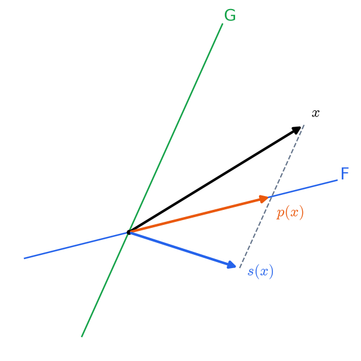
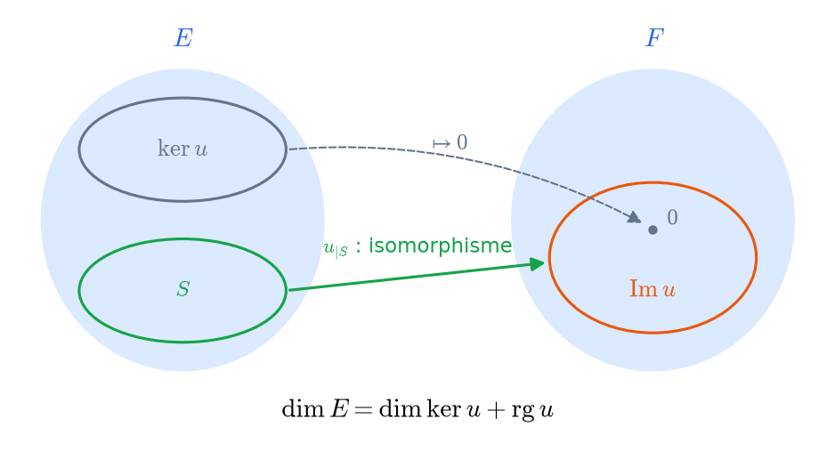

# Algèbre linéaire
CAPES : algèbre linéaire. Agrég : titre 1.1, 1.2.

## Systèmes linéaires et pivot de Gauss
**Système** $AX=B$ avec $A\in\mathcal M_{n,p}(K)$. L'ensemble des solutions est vide ou de la forme $X_0+\ker A$ : une solution particulière plus la solution générale du système homogène.

**Opérations élémentaires sur les lignes** : échange, dilatation par un scalaire non nul, transvection $L_i\leftarrow L_i+\lambda L_j$. Chacune correspond à une multiplication à gauche par une matrice inversible, donc ne change pas l'ensemble des solutions.

**Algorithme de Gauss–Jordan.** On met $A$ sous forme **échelonnée réduite**. Les colonnes des pivots donnent les inconnues principales, les autres sont des paramètres.
- Le rang est le nombre de pivots.
- Le système est compatible si et seulement s'il n'apparaît pas de ligne $0=c$ avec $c\ne0$ (rang de $A$ = rang de $(A|B)$).
- Le coût est en $O(n^3)$ opérations.

**Applications du pivot.**
- Inverser $A$ : réduire $(A\,|\,I_n)$ en $(I_n\,|\,A^{-1})$.
- Calculer un déterminant : produit des pivots, au signe des échanges près.
- Calculer le rang.
- Trouver des équations d'un sous-espace engendré (éliminer les paramètres).

**Systèmes de Cramer** ($A$ inversible) : il y a une unique solution, avec $x_i=\det A_i/\det A$. La formule est utile en théorie, mais trop coûteuse en pratique.

Sources : [Wikipédia – Élimination de Gauss-Jordan](https://fr.wikipedia.org/wiki/%C3%89limination_de_Gauss-Jordan) · [Wikipédia – Système d'équations linéaires](https://fr.wikipedia.org/wiki/Syst%C3%A8me_d%27%C3%A9quations_lin%C3%A9aires)

## Espaces vectoriels et sommes directes
**Espace vectoriel** sur $K$. Exemples :
- $K^n$, $\mathcal M_{n,p}(K)$, $K[X]$, $K_n[X]$ ;
- $\mathcal F(X,K)$ et les suites $K^{\mathbb N}$ ;
- $\mathcal C^k(I,\mathbb R)$ et les solutions d'une équation différentielle linéaire homogène.

**Sous-espace vectoriel** : non vide et stable par combinaisons linéaires. Une intersection de sous-espaces en est un ; une réunion l'est seulement si l'un contient l'autre. $\mathrm{Vect}(A)$ est le plus petit sous-espace contenant $A$ : l'ensemble des combinaisons linéaires finies.

**Somme** $F+G=\{f+g\}$. Elle est **directe** si la décomposition est unique, ce qui équivaut à $F\cap G=\{0\}$ pour deux sous-espaces.
- Pour plus de deux sous-espaces, il ne suffit pas que les intersections deux à deux soient nulles. Le bon critère : $\sum x_i=0\Rightarrow$ tous les $x_i=0$, ou bien $\dim\sum F_i=\sum\dim F_i$ en dimension finie.

**Supplémentaires** : $E=F\oplus G$. Il en existe toujours en dimension finie (base incomplète) ; ils ne sont pas uniques.

**Exemples à connaître.**
- $\mathcal M_n=\mathcal S_n\oplus\mathcal A_n$ (en caractéristique $\ne2$).
- Fonctions paires et fonctions impaires.
- $K[X]=(P)\oplus K_{n-1}[X]$ pour $\deg P=n$ (division euclidienne).

Sources : [Wikipédia – Espace vectoriel](https://fr.wikipedia.org/wiki/Espace_vectoriel) · [Wikipédia – Somme directe](https://fr.wikipedia.org/wiki/Somme_directe) · [Le Frido](https://laurent.claessens-donadello.eu/frido.html)

## Familles libres, génératrices, bases et dimension
**Famille libre** : $\sum\lambda_ix_i=0\Rightarrow\lambda_i=0$. **Génératrice** : $\mathrm{Vect}=E$. **Base** : les deux à la fois, c'est-à-dire que tout vecteur a des coordonnées uniques.

**Lemme fondamental.** Dans un espace engendré par $n$ vecteurs, toute famille de $n+1$ vecteurs est liée. C'est l'ingrédient clé : la preuve se fait par récurrence sur $n$ (élimination).

**Conséquences en dimension finie.**
- Toutes les bases ont le même cardinal, la **dimension**.
- **Théorème de la base incomplète** : toute famille libre se complète en base avec des vecteurs d'une famille génératrice donnée, et de toute famille génératrice on extrait une base.
- Si $\dim E=n$ : une famille libre de $n$ vecteurs est une base, et de même pour une famille génératrice de $n$ vecteurs.
- Si $F\subset E$, alors $\dim F\le\dim E$, avec égalité si et seulement si $F=E$.
- **Formule de Grassmann** : $\dim(F+G)=\dim F+\dim G-\dim(F\cap G)$.

**Exemples.**
- Bases canoniques ; base de Lagrange de $K_n[X]$ ; bases de Taylor $(X-a)^k$.
- Une famille de polynômes de degrés échelonnés est libre.
- Les $x\mapsto e^{\lambda x}$ pour des $\lambda$ distincts forment une famille libre (vecteurs propres de la dérivation).

**Piège.** Une famille de vecteurs deux à deux non colinéaires n'est pas forcément libre.

Sources : [Wikipédia – Base (algèbre linéaire)](https://fr.wikipedia.org/wiki/Base_%28alg%C3%A8bre_lin%C3%A9aire%29) · [Wikipédia – Dimension d'un espace vectoriel](https://fr.wikipedia.org/wiki/Dimension_d%27un_espace_vectoriel) · [Wikipédia – Théorème de la base incomplète](https://fr.wikipedia.org/wiki/Th%C3%A9or%C3%A8me_de_la_base_incompl%C3%A8te)

## Applications linéaires
**Application linéaire** $u:E\to F$ : $u(\lambda x+y)=\lambda u(x)+u(y)$. $\mathcal L(E,F)$ est un espace vectoriel ; $\mathcal L(E)$ est une algèbre et $GL(E)$ un groupe.

**Noyau et image** : des sous-espaces. $u$ est injective $\iff\ker u=\{0\}$.

**Détermination par une base.** Une application linéaire est entièrement déterminée par l'image d'une base, et ces images sont arbitraires. Ainsi :
- $u$ est injective $\iff$ l'image d'une base est libre ;
- $u$ est surjective $\iff$ l'image d'une base est génératrice ;
- $u$ est un isomorphisme $\iff$ l'image d'une base est une base.

Deux espaces de dimension finie sont isomorphes si et seulement s'ils ont la même dimension ; tout espace de dimension $n$ est isomorphe à $K^n$.

**Dimension** : $\dim\mathcal L(E,F)=\dim E\cdot\dim F$.

**Exemples.**
- Dérivation sur $K[X]$ : surjective et non injective, ce qui n'est possible qu'en dimension infinie.
- Décalage sur les suites : injectif et non surjectif.
- Évaluation en des points ; la trace ; la transposition.

**Endomorphismes en dimension finie** : injectif $\iff$ surjectif $\iff$ bijectif. C'est faux en dimension infinie (voir la dérivation).

**Formes linéaires et hyperplans.** Un hyperplan est le noyau d'une forme linéaire non nulle, définie à un scalaire près.

Sources : [Wikipédia – Application linéaire](https://fr.wikipedia.org/wiki/Application_lin%C3%A9aire) · [Wikipédia – Noyau (algèbre)](https://fr.wikipedia.org/wiki/Noyau_%28alg%C3%A8bre%29)

## Homothéties, projecteurs et symétries
**Homothéties** $\lambda\,\mathrm{id}$. Ce sont les seuls endomorphismes qui commutent avec tous les autres, ou qui laissent stable toute droite.

**Projecteur** $p$ sur $F$ parallèlement à $G$, où $E=F\oplus G$ : il envoie $x=f+g$ sur $f$.
- **Caractérisation** : $p$ est un projecteur $\iff p\circ p=p$. Alors $E=\operatorname{Im}p\oplus\ker p$, et $p$ est la projection sur $\operatorname{Im}p$ parallèlement à $\ker p$.
- $\operatorname{Im}p=\ker(p-\mathrm{id})$ et $\operatorname{rg}p=\operatorname{tr}p$. La matrice est $\mathrm{diag}(I_r,0)$ dans une base adaptée.

**Symétrie** $s$ par rapport à $F$ parallèlement à $G$ : elle envoie $f+g$ sur $f-g$.
- **Caractérisation** (en caractéristique $\ne2$) : $s\circ s=\mathrm{id}$. Alors $E=\ker(s-\mathrm{id})\oplus\ker(s+\mathrm{id})$.
- **Lien** : $s=2p-\mathrm{id}$.
- La matrice est $\mathrm{diag}(I_r,-I_{n-r})$ dans une base adaptée.

**Méthode.** Pour décomposer $x$, on écrit $x=p(x)+(x-p(x))$ ; pour une symétrie, $x=\frac{x+s(x)}2+\frac{x-s(x)}2$. C'est le schéma de la décomposition paire/impaire et symétrique/antisymétrique.

**Polynômes annulateurs.** $X^2-X$ pour les projecteurs et $X^2-1$ pour les symétries sont scindés à racines simples, d'où la diagonalisabilité (voir le chapitre 06).

Sources : [Wikipédia – Projecteur (mathématiques)](https://fr.wikipedia.org/wiki/Projecteur_%28math%C3%A9matiques%29) · [Wikipédia – Symétrie (transformation géométrique)](https://fr.wikipedia.org/wiki/Sym%C3%A9trie_%28transformation_g%C3%A9om%C3%A9trique%29)

## Théorème du rang
**Rang** : $\operatorname{rg}u=\dim\operatorname{Im}u$, c'est-à-dire le rang de la famille des images d'une base, ou celui des colonnes de la matrice.

**Théorème du rang.** Si $E$ est de dimension finie, $\dim E=\dim\ker u+\operatorname{rg}u$.
- Preuve : un supplémentaire $S$ de $\ker u$ est isomorphe à $\operatorname{Im}u$ par $u_{|S}$. Pour l'injectivité, $\ker u\cap S=\{0\}$ ; pour la surjectivité, $u(k+s)=u(s)$.
- C'est une forme du premier théorème d'isomorphisme : $E/\ker u\simeq\operatorname{Im}u$.

**Conséquences.**
- Si $\dim E=\dim F$ : injective $\iff$ surjective $\iff$ bijective.
- $\operatorname{rg}(v\circ u)\le\min(\operatorname{rg}u,\operatorname{rg}v)$. Composer par un isomorphisme ne change pas le rang.
- Un système homogène à $p$ inconnues de rang $r$ a un espace de solutions de dimension $p-r$.
- **Inégalité de Sylvester** : $\operatorname{rg}u+\operatorname{rg}v-n\le\operatorname{rg}(v\circ u)$.

**Rang d'une matrice.** $\operatorname{rg}A=\operatorname{rg}{}^tA$ : le rang des lignes égale le rang des colonnes. C'est aussi la taille maximale d'un mineur non nul.

**Piège.** Le théorème ne dit pas que $E=\ker u\oplus\operatorname{Im}u$ (pour un endomorphisme). C'est faux en général : par exemple pour $u$ nilpotent non nul.

Sources : [Wikipédia – Théorème du rang](https://fr.wikipedia.org/wiki/Th%C3%A9or%C3%A8me_du_rang) · [Wikipédia – Rang (algèbre linéaire)](https://fr.wikipedia.org/wiki/Rang_%28alg%C3%A8bre_lin%C3%A9aire%29)

## Matrices et changement de base
**Matrice de $u$** dans les bases $\mathcal B$ et $\mathcal C$ : la colonne $j$ contient les coordonnées de $u(e_j)$. On a $\mathrm{Mat}(v\circ u)=\mathrm{Mat}(v)\,\mathrm{Mat}(u)$, ce qui justifie la définition du produit matriciel.

**Changement de base.** $P=P_{\mathcal B\to\mathcal B'}$ a pour colonnes les coordonnées des nouveaux vecteurs dans l'ancienne base.
- Pour les coordonnées : $X=PX'$, l'ancienne colonne étant donnée en fonction de la nouvelle.
- Pour une application linéaire : $A'=Q^{-1}AP$. Pour un endomorphisme : $A'=P^{-1}AP$.

**Équivalence** : $A'=QAP$ avec $P,Q$ inversibles. Deux matrices sont équivalentes si et seulement si elles ont même rang : toute matrice de rang $r$ est équivalente à $J_r=\begin{pmatrix}I_r&0\\0&0\end{pmatrix}$.

**Similitude** : $A'=P^{-1}AP$. Ses invariants sont la trace, le déterminant, le polynôme caractéristique, le rang et le polynôme minimal. Ils ne suffisent pas à caractériser la classe en général (il faut les invariants de similitude, ou Jordan).

**Inversibilité** : $A\in GL_n\iff\operatorname{rg}A=n\iff\det A\ne0\iff\ker A=\{0\}\iff$ $A$ est inversible à gauche (ou à droite).

**Transposition** : ${}^t(AB)={}^tB\,{}^tA$ ; $({}^tA)^{-1}={}^t(A^{-1})$.

**Calcul par blocs.** Les produits par blocs se font comme pour des matrices de nombres, si les tailles sont compatibles. Un sous-espace stable donne une matrice triangulaire par blocs.

Sources : [Wikipédia – Matrice de passage](https://fr.wikipedia.org/wiki/Matrice_de_passage) · [Wikipédia – Matrices semblables](https://fr.wikipedia.org/wiki/Matrices_semblables) · [Wikipédia – Matrices équivalentes](https://fr.wikipedia.org/wiki/Matrices_%C3%A9quivalentes)

## Déterminant
**Formes $n$-linéaires alternées.** Sur un espace de dimension $n$, elles forment une droite. $\det_{\mathcal B}$ est l'unique telle forme qui vaut $1$ sur $\mathcal B$.

**Déterminant d'une matrice** : $\det A=\sum_{\sigma\in\mathfrak S_n}\varepsilon(\sigma)\prod_i a_{\sigma(i),i}$.
**Déterminant d'un endomorphisme** : $\det u$ est défini par $\det_{\mathcal B}(u(e_1),\dots,u(e_n))$. Il ne dépend pas de la base.

**Propriétés.**
- $\det(AB)=\det A\det B$ et $\det{}^tA=\det A$.
- $A$ est inversible $\iff\det A\ne0$, et $\det$ induit un morphisme $GL_n(K)\to K^*$.
- Une famille de $n$ vecteurs est une base $\iff$ son déterminant dans une base est non nul.

**Calcul.**
- Opérations élémentaires : une transvection ne change rien, un échange change le signe, une dilatation multiplie par le scalaire.
- Matrices triangulaires (par blocs) : produit des coefficients (des blocs) diagonaux.
- Développement selon une ligne ou une colonne (cofacteurs).
- $A\,{}^t\mathrm{Com}(A)=\det(A)\,I_n$, d'où $A^{-1}=\frac1{\det A}{}^t\mathrm{Com}A$.

**Déterminants classiques.** **Vandermonde** : $\det(x_j^{i-1})=\prod_{i<j}(x_j-x_i)$ (récurrence et polynôme en $x_n$). Aussi les déterminants circulants et tridiagonaux (récurrence linéaire d'ordre 2).

**Interprétation géométrique** (sur $\mathbb R$) : volume orienté du parallélotope, et coefficient multiplicateur des volumes (ce qui donne le changement de variables).

Sources : [Wikipédia – Déterminant (mathématiques)](https://fr.wikipedia.org/wiki/D%C3%A9terminant_%28math%C3%A9matiques%29) · [Wikipédia – Matrice de Vandermonde](https://fr.wikipedia.org/wiki/Matrice_de_Vandermonde) · [Le Frido](https://laurent.claessens-donadello.eu/frido.html)

## Trace
**Définition.** $\operatorname{tr}A=\sum a_{ii}$. C'est une forme linéaire, et $\operatorname{tr}(AB)=\operatorname{tr}(BA)$, même pour $A\in\mathcal M_{n,p}$ et $B\in\mathcal M_{p,n}$.

**Invariance par similitude.** $\operatorname{tr}(P^{-1}AP)=\operatorname{tr}A$, d'où la trace d'un endomorphisme. Attention : $\operatorname{tr}(ABC)\ne\operatorname{tr}(BAC)$ en général. Seules les permutations circulaires sont permises.

**Lien avec les valeurs propres.** $\operatorname{tr}A=\sum\lambda_i$, avec multiplicités dans un corps où $\chi_A$ est scindé. C'est le coefficient de $X^{n-1}$ dans $\chi_A$, au signe près.

**Résultats classiques.**
- Pour un projecteur, $\operatorname{tr}p=\operatorname{rg}p$.
- Il n'existe pas de $A,B$ avec $AB-BA=I_n$ en caractéristique nulle (prendre la trace).
- Les formes linéaires sur $\mathcal M_n(K)$ sont les $M\mapsto\operatorname{tr}(AM)$.
- $\ker\operatorname{tr}$ est engendré par les commutateurs $AB-BA$, et c'est un hyperplan.
- Une matrice de trace nulle est semblable à une matrice de diagonale nulle (agrég).
- Un produit scalaire sur $\mathcal M_n(\mathbb R)$ : $\langle A,B\rangle=\operatorname{tr}({}^tAB)$.

**Trace et nilpotence** (caractéristique nulle) : $A$ est nilpotente $\iff\operatorname{tr}A^k=0$ pour tout $k\ge1$ (sommes de Newton, ou Vandermonde).

Sources : [Wikipédia – Trace (algèbre)](https://fr.wikipedia.org/wiki/Trace_%28alg%C3%A8bre%29)

## Espaces quotients @agreg
**Quotient** $E/F$ : l'ensemble des classes $x+F$, muni d'une structure d'espace vectoriel qui rend linéaire la surjection canonique $\pi$, de noyau $F$.

**Propriété universelle.** Si $u:E\to G$ s'annule sur $F$, elle se factorise de façon unique en $\bar u:E/F\to G$. **Factorisation canonique** : $E/\ker u\simeq\operatorname{Im}u$.

**Dimension.** Tout supplémentaire $S$ de $F$ est isomorphe à $E/F$ (via $\pi_{|S}$), donc $\dim E/F=\dim E-\dim F$ ; on parle de **codimension**.

**Utilisations.**
- Récurrences en réduction : si $F$ est stable par $u$, $u$ induit $\bar u$ sur $E/F$ et $\chi_u=\chi_{u_{|F}}\chi_{\bar u}$. C'est la preuve intrinsèque de la trigonalisation et de Cayley–Hamilton.
- Formes bilinéaires : on passe au quotient par le noyau pour obtenir une forme non dégénérée.
- Analyse : $L^p$ est un quotient par les fonctions nulles presque partout.

**Exemples.** $K[X]/(P)$, de base $1,\bar X,\dots,\bar X^{n-1}$ ; $\mathbb R^{\mathbb N}/c_0$ (les suites modulo celles qui tendent vers $0$).

Sources : [Wikipédia – Espace vectoriel quotient](https://fr.wikipedia.org/wiki/Espace_vectoriel_quotient) · [Le Frido](https://laurent.claessens-donadello.eu/frido.html)

## Dualité @agreg
**Dual** $E^*=\mathcal L(E,K)$. **Base duale** $(e_i^*)$ : $e_i^*(e_j)=\delta_{ij}$, et $e_i^*$ est la $i$-ème coordonnée. En dimension finie, $\dim E^*=\dim E$.

**Bidual.** $E\to E^{**}$, $x\mapsto(\varphi\mapsto\varphi(x))$ est un isomorphisme canonique en dimension finie. Toute base de $E^*$ est la duale d'une unique base de $E$ (base antéduale).

**Orthogonalité.**
- $F^\circ=\{\varphi : \varphi_{|F}=0\}$, avec $\dim F+\dim F^\circ=\dim E$, et $(F^\circ)^\circ=F$ dans le bidual.
- Un sous-espace de dimension $p$ est l'intersection de $n-p$ hyperplans, c'est-à-dire décrit par $n-p$ équations linéairement indépendantes.

**Transposée** ${}^tu:F^*\to E^*$, $\varphi\mapsto\varphi\circ u$. Sa matrice dans les bases duales est la transposée. $\ker{}^tu=(\operatorname{Im}u)^\circ$ et $\operatorname{Im}{}^tu=(\ker u)^\circ$, ce qui redonne $\operatorname{rg}{}^tA=\operatorname{rg}A$.

**Exemples.**
- Formes linéaires $P\mapsto P(a_i)$ sur $K_n[X]$ : leur base antéduale est la base de Lagrange.
- $P\mapsto\int_0^1P$ et les formules de quadrature exactes.
- Représentation $\varphi=\operatorname{tr}(A\,\cdot)$ sur $\mathcal M_n$.

**Hyperplans.** Si $\varphi_1,\dots,\varphi_p$ sont des formes linéaires, alors $\varphi\in\mathrm{Vect}(\varphi_i)\iff\bigcap\ker\varphi_i\subset\ker\varphi$.

Sources : [Wikipédia – Espace dual](https://fr.wikipedia.org/wiki/Espace_dual) · [Wikipédia – Base duale](https://fr.wikipedia.org/wiki/Base_duale) · [Le Frido](https://laurent.claessens-donadello.eu/frido.html)
