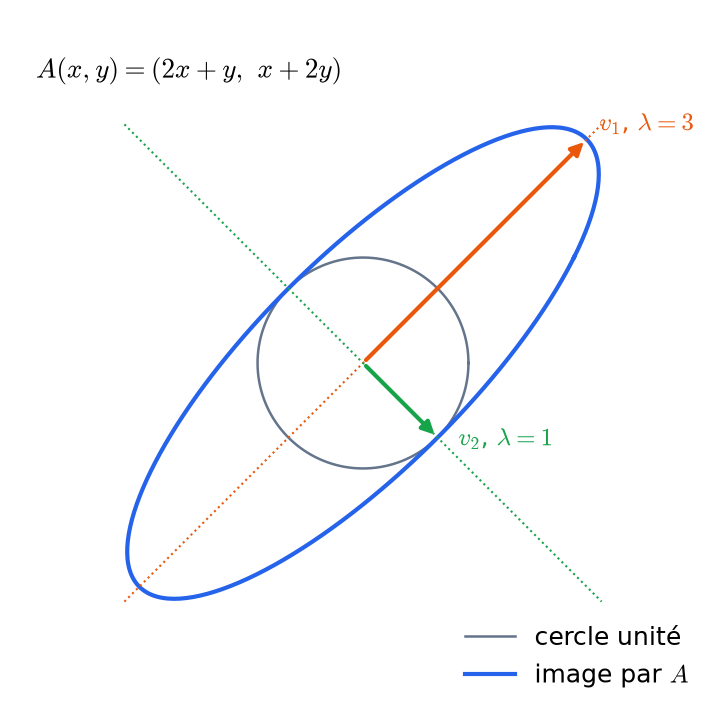

# Réduction des endomorphismes
CAPES : réduction, Cayley-Hamilton admis. Agrég : titre 1.1 (b), 1.2 (d).

## Éléments propres et polynôme caractéristique
**Valeur propre** $\lambda$ de $u$ : $\ker(u-\lambda\,\mathrm{id})\ne\{0\}$. Ce noyau est le **sous-espace propre** $E_\lambda$, et le **spectre** $\mathrm{Sp}(u)$ est l'ensemble des valeurs propres.
- Des sous-espaces propres associés à des valeurs propres distinctes sont **en somme directe**. En particulier, des vecteurs propres associés à des valeurs propres distinctes forment une famille libre.

**Polynôme caractéristique** $\chi_A=\det(XI_n-A)$, unitaire de degré $n$ :
$$\chi_A=X^n-\operatorname{tr}(A)X^{n-1}+\dots+(-1)^n\det A$$
- Les valeurs propres sont exactement les racines de $\chi_A$ dans $K$.
- $\chi$ est invariant par similitude, et $\chi_{AB}=\chi_{BA}$.
- Pour une matrice triangulaire (par blocs), c'est le produit des polynômes caractéristiques des blocs diagonaux.
- Un sous-espace stable $F$ donne $\chi_{u_{|F}}\mid\chi_u$.

**Multiplicités.** Pour $\lambda$ valeur propre : $1\le\dim E_\lambda\le m_\lambda$, où $m_\lambda$ est la multiplicité de $\lambda$ comme racine de $\chi$.

**Sur $\mathbb C$**, tout endomorphisme a au moins une valeur propre. Sur $\mathbb R$, ce n'est pas toujours le cas : une rotation d'angle $\ne0,\pi$ n'en a pas. En dimension impaire, il y en a toujours une.

**Matrice compagnon** de $P=X^n+a_{n-1}X^{n-1}+\dots+a_0$ : son polynôme caractéristique est $P$. Tout polynôme unitaire est donc un polynôme caractéristique.

Sources : [Wikipédia – Valeur propre, vecteur propre et espace propre](https://fr.wikipedia.org/wiki/Valeur_propre,_vecteur_propre_et_espace_propre) · [Wikipédia – Polynôme caractéristique](https://fr.wikipedia.org/wiki/Polyn%C3%B4me_caract%C3%A9ristique)

## Polynômes d'endomorphismes et polynôme minimal
**Polynômes en $u$.** $P\mapsto P(u)$ est un morphisme d'algèbres $K[X]\to\mathcal L(E)$, d'image la sous-algèbre commutative $K[u]$. Les sous-espaces $\ker P(u)$ et $\operatorname{Im}P(u)$ sont stables par $u$, et plus généralement par tout endomorphisme qui commute avec $u$.

**Polynôme annulateur** : $P(u)=0$. Il en existe en dimension finie, car $\dim\mathcal L(E)=n^2$. Les polynômes annulateurs forment un idéal non nul, engendré par le **polynôme minimal** $\mu_u$ (unitaire). On a $\dim K[u]=\deg\mu_u$.

**Lien avec les valeurs propres.** Si $P(u)=0$ et $u(x)=\lambda x$, alors $P(\lambda)x=0$. Donc $\mathrm{Sp}(u)\subset$ racines de tout polynôme annulateur, et les racines de $\mu_u$ sont exactement les valeurs propres.

**Théorème de Cayley–Hamilton.** $\chi_u(u)=0$, donc $\mu_u\mid\chi_u$ et $\deg\mu_u\le n$. (Admis au CAPES ; à démontrer à l'agrégation.) Preuves :
- par les matrices compagnons, sur le sous-espace cyclique $\mathrm{Vect}(u^k(x))$ ;
- par densité des matrices diagonalisables dans $\mathcal M_n(\mathbb C)$ ;
- par la comatrice, à coefficients dans $K[X]$.

**Piège.** La « preuve » $\chi_A(A)=\det(AI-A)=0$ est fausse : on remplace un scalaire par une matrice à l'intérieur du déterminant.

**Utilisations.**
- Calcul de $A^{-1}$ comme polynôme en $A$ (si $\det A\ne0$).
- Calcul de $A^k$ par division euclidienne de $X^k$ par un polynôme annulateur.
- Suites récurrentes linéaires.

Sources : [Wikipédia – Polynôme minimal d'un endomorphisme](https://fr.wikipedia.org/wiki/Polyn%C3%B4me_minimal_d%27un_endomorphisme) · [Wikipédia – Théorème de Cayley-Hamilton](https://fr.wikipedia.org/wiki/Th%C3%A9or%C3%A8me_de_Cayley-Hamilton) · [Le Frido](https://laurent.claessens-donadello.eu/frido.html)

## Diagonalisation
**Diagonalisable** : il existe une base de vecteurs propres, c'est-à-dire que $A$ est semblable à une matrice diagonale.

**Critères équivalents.**
1. $E=\bigoplus_\lambda E_\lambda$, c'est-à-dire $\sum\dim E_\lambda=n$.
2. $\chi_u$ est scindé et $\dim E_\lambda=m_\lambda$ pour toute valeur propre.
3. Il existe un polynôme annulateur **scindé à racines simples**, ou encore $\mu_u$ est scindé à racines simples (par le lemme des noyaux).

**Condition suffisante.** $\chi_u$ scindé à racines simples, c'est-à-dire $n$ valeurs propres distinctes. Elle n'est pas nécessaire : penser à $I_n$.

**Conséquences.**
- Si $u$ est diagonalisable et $F$ stable par $u$, alors $u_{|F}$ est diagonalisable (par le critère du polynôme annulateur).
- **Codiagonalisation** : une famille d'endomorphismes diagonalisables qui commutent deux à deux est diagonalisable dans une base commune.
- Projecteurs ($X^2-X$) et symétries ($X^2-1$) sont diagonalisables.

**Méthode.**
1. Calculer $\chi$ et le factoriser.
2. Pour chaque valeur propre, calculer $\dim E_\lambda=n-\operatorname{rg}(A-\lambda I)$.
3. Si la somme vaut $n$, la matrice de passage $P$ a pour colonnes les vecteurs propres, et $A=PDP^{-1}$.

**Applications.**
- $A^k=PD^kP^{-1}$ : suites récurrentes linéaires, chaînes de Markov.
- Systèmes différentiels $X'=AX$.
- Commutant d'une matrice à valeurs propres distinctes : il est égal à $K[A]$.

**Contre-exemples.** $\begin{pmatrix}0&1\\0&0\end{pmatrix}$ (nilpotent non nul) ; une rotation sur $\mathbb R$ (polynôme non scindé, mais diagonalisable sur $\mathbb C$).

Sources : [Wikipédia – Matrice diagonalisable](https://fr.wikipedia.org/wiki/Matrice_diagonalisable) · [Wikipédia – Diagonalisation](https://fr.wikipedia.org/wiki/Diagonalisation)

## Trigonalisation
**Trigonalisable** : il existe une base où la matrice est triangulaire supérieure, c'est-à-dire un drapeau $F_1\subset\dots\subset F_n$ de sous-espaces stables avec $\dim F_k=k$.

**Théorème.** $u$ est trigonalisable $\iff\chi_u$ est scindé sur $K$.
- Preuve : récurrence sur $n$. On prend un vecteur propre $e_1$ ; l'endomorphisme induit sur $E/Ke_1$ (ou le bloc $A'$ de taille $n-1$) a un polynôme caractéristique scindé ($\chi_u=(X-\lambda)\chi_{A'}$).
- Sur $\mathbb C$, toute matrice est trigonalisable.

**Conséquences.**
- $\operatorname{tr}A=\sum\lambda_i$ et $\det A=\prod\lambda_i$ (avec multiplicités).
- **Valeurs propres de $P(A)$** : ce sont les $P(\lambda_i)$, avec multiplicités. Par exemple, $A$ nilpotente $\iff\mathrm{Sp}_{\mathbb C}(A)=\{0\}$.
- Une preuve de Cayley–Hamilton : on montre $\prod(u-\lambda_i)(F_k)\subset F_{k-1}$ de proche en proche.
- **Cotrigonalisation** des endomorphismes qui commutent (sur $\mathbb C$).

**Densité.** Les matrices diagonalisables sont denses dans $\mathcal M_n(\mathbb C)$ : on trigonalise, puis on perturbe la diagonale pour rendre les valeurs propres distinctes.

**Méthode pratique** en dimension 2 ou 3 : prendre un vecteur propre et compléter, ou bien chercher la réduite de Jordan $\begin{pmatrix}\lambda&1\\0&\lambda\end{pmatrix}$ en résolvant $(A-\lambda I)v_2=v_1$.

Sources : [Wikipédia – Matrice triangularisable](https://fr.wikipedia.org/wiki/Matrice_triangularisable) · [Wikipédia – Réduction de Jordan](https://fr.wikipedia.org/wiki/R%C3%A9duction_de_Jordan)

## Lemme des noyaux et sous-espaces caractéristiques @agreg
**Lemme des noyaux.** Si $P=P_1\cdots P_r$ avec les $P_i$ premiers entre eux deux à deux, alors
$$\ker P(u)=\ker P_1(u)\oplus\cdots\oplus\ker P_r(u),$$
et les projecteurs associés sont des **polynômes en $u$**.
- Preuve pour deux facteurs : par Bézout $U_1P_1+U_2P_2=1$, on écrit $x=U_1P_1(u)x+U_2P_2(u)x$.

**Sous-espaces caractéristiques.** Si $\chi_u=\prod(X-\lambda_i)^{m_i}$ est scindé, on pose $N_i=\ker(u-\lambda_i)^{m_i}$. Alors :
- $E=\bigoplus N_i$ ;
- $\dim N_i=m_i$ ;
- $u_{|N_i}=\lambda_i\,\mathrm{id}+$ nilpotent.

On obtient une décomposition par blocs $\mathrm{diag}(\lambda_iI+N_i)$.

**Indice.** $\ker(u-\lambda)^k$ croît strictement, puis stationne à partir de l'indice $\nu_\lambda$, qui est la multiplicité de $\lambda$ dans $\mu_u$.

**Applications.**
- Critère de diagonalisabilité par le polynôme minimal.
- Décomposition de Dunford.
- Solutions des équations différentielles et des récurrences linéaires à coefficients constants : $\ker P(D)$ est la somme directe des $\ker(D-\lambda)^m$, ce qui donne les solutions $t^ke^{\lambda t}$.

Sources : [Wikipédia – Lemme des noyaux](https://fr.wikipedia.org/wiki/Lemme_des_noyaux) · [Wikipédia – Sous-espace caractéristique](https://fr.wikipedia.org/wiki/Sous-espace_caract%C3%A9ristique) · [Le Frido](https://laurent.claessens-donadello.eu/frido.html)

## Endomorphismes nilpotents @agreg
**Nilpotent** : $u^k=0$ pour un certain $k$. L'**indice** $p$ est le plus petit tel $k$, et $p\le n$.

**Caractérisations** (sur un corps $K$) : $u$ nilpotent $\iff\chi_u=X^n\iff$ $u$ est semblable à une matrice triangulaire stricte. En caractéristique nulle, c'est aussi équivalent à $\operatorname{tr}u^k=0$ pour tout $k$.

**Propriétés.**
- Si $u^{p-1}(x)\ne0$, la famille $x,u(x),\dots,u^{p-1}(x)$ est libre.
- Somme et produit de nilpotents qui commutent sont nilpotents.
- $\mathrm{id}+u$ est inversible, d'inverse $\sum(-1)^ku^k$.

**Réduction de Jordan des nilpotents.** $u$ est semblable à $\mathrm{diag}(J_{k_1},\dots,J_{k_r})$, où $J_k$ est le bloc de Jordan (des $1$ sur la sur-diagonale).
- Les tailles forment une partition de $n$, déterminée par les $\dim\ker u^j$ (tableau de Young).
- Deux nilpotents sont semblables si et seulement s'ils ont les mêmes $\operatorname{rg}u^j$ pour tout $j$.

**Nombre de nilpotents sur $\mathbb F_q$** (développement) : $q^{n^2-n}$ (théorème de Fine–Herstein).

**Cône nilpotent** : un fermé de $\mathcal M_n(\mathbb C)$. L'orbite de similitude d'un nilpotent adhère à $0$, car $\varepsilon J$ est semblable à $J$.

Sources : [Wikipédia – Endomorphisme nilpotent](https://fr.wikipedia.org/wiki/Endomorphisme_nilpotent) · [Wikipédia – Réduction de Jordan](https://fr.wikipedia.org/wiki/R%C3%A9duction_de_Jordan)

## Décomposition de Dunford @agreg
**Théorème.** Si $\chi_u$ est scindé, il existe un unique couple $(d,n)$ avec :
- $d$ diagonalisable et $n$ nilpotent ;
- $u=d+n$ ;
- $dn=nd$.

De plus, $d$ et $n$ sont des **polynômes en $u$**.

**Preuve.**
- Existence : on pose $d=\sum\lambda_ip_i$, où les $p_i$ sont les projecteurs sur les sous-espaces caractéristiques (polynômes en $u$ par le lemme des noyaux).
- Unicité : si $u=d'+n'$, alors $d'$ et $n'$ commutent avec $u$, donc avec $d$ et $n$. Ainsi $d-d'=n'-n$ est à la fois diagonalisable (codiagonalisation) et nilpotent, donc nul.

**Piège.** Il ne suffit pas d'écrire « diagonale + triangulaire stricte » : $\begin{pmatrix}1&1\\0&2\end{pmatrix}$ est diagonalisable, donc sa décomposition de Dunford est $(A,0)$.

**Applications.**
- **Exponentielle** : $e^u=e^de^n$, avec $e^n$ une somme finie.
- Puissances $u^k=\sum_{j<p}\binom kj d^{k-j}n^j$.
- $u$ est diagonalisable $\iff n=0$.
- $e^A$ est diagonalisable $\iff A$ est diagonalisable (sur $\mathbb C$).

**Algorithme effectif** : méthode de Newton $u_{k+1}=u_k-P(u_k)P'(u_k)^{-1}$, avec $P$ le radical de $\chi_u$ ; aucune factorisation n'est nécessaire.

Sources : [Wikipédia – Décomposition de Dunford](https://fr.wikipedia.org/wiki/D%C3%A9composition_de_Dunford) · [Le Frido](https://laurent.claessens-donadello.eu/frido.html)

## Exponentielle de matrices @agreg
**Définition.** $e^A=\sum_{k\ge0}\frac{A^k}{k!}$. La série converge normalement pour toute norme d'algèbre, et $\|e^A\|\le e^{\|A\|}$.

**Propriétés.**
- Si $AB=BA$, alors $e^{A+B}=e^Ae^B$. Sans commutation, c'est faux.
- $e^A$ est inversible d'inverse $e^{-A}$, et $e^{P^{-1}AP}=P^{-1}e^AP$.
- $\det e^A=e^{\operatorname{tr}A}$ (trigonalisation). Ainsi $\exp(\mathcal M_n(\mathbb R))\subset GL_n^+(\mathbb R)$, sans égalité.
- $e^A$ est un polynôme en $A$, qui dépend de $A$.
- $t\mapsto e^{tA}$ est $\mathcal C^\infty$, de dérivée $Ae^{tA}$. C'est l'unique solution de $M'=AM$ avec $M(0)=I$.

**Calcul.**
- Cas diagonalisable : $e^{PDP^{-1}}=Pe^DP^{-1}$.
- Cas général : Dunford, ou bien interpolation de Lagrange-Hermite sur le spectre.
- Exemple : $\exp\begin{pmatrix}0&-\theta\\\theta&0\end{pmatrix}=R_\theta$ (rotation).

**Images.**
- $\exp:\mathcal M_n(\mathbb C)\to GL_n(\mathbb C)$ est **surjective** (développement).
- $\exp:\mathcal A_n(\mathbb R)\to SO(n)$ est surjective.
- $\exp:\mathcal S_n(\mathbb R)\to\mathcal S_n^{++}(\mathbb R)$ est un homéomorphisme.

**Applications** : systèmes différentiels linéaires $X'=AX$, de solution $X(t)=e^{tA}X_0$ ; stabilité ($e^{tA}\to0\iff$ toutes les valeurs propres ont une partie réelle $<0$) ; groupes à un paramètre.

Sources : [Wikipédia – Exponentielle d'une matrice](https://fr.wikipedia.org/wiki/Exponentielle_d%27une_matrice) · [Le Frido](https://laurent.claessens-donadello.eu/frido.html)
